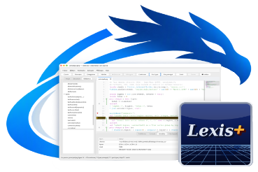

Lexis+ &
wdlexis+ — l'atelier du langage Lexis+<br/>
© 2026 Jean‑Marc "jihem"Quéré, sonaliwan.fr<br/>
SIRET 13033319800013<br/>
Distribué sous licence CC BY‑NC‑SA 4.0.<br/>

Les utilisations commerciales ne sont pas couvertes par cette licence.<br/>
Pour obtenir une autorisation d'utilisation commerciale,<br/>
contactez l'auteur : metalab (at) sonaliwan.fr.<br/>

[]()

# Lexis+ et l'atelier wdlexis+

**Lexis+ — Développez naturellement vos applications métier**

Ce document décrit le langage Lexis+ tel qu'il s'utilise sur le poste de travail
avec l'atelier **wdlexis+** et le runtime **wdlexisrt** : le langage, la base de
données, l'interface graphique, le multitâche, l'atelier, puis la référence
complète des fonctions intégrées et des paquets. Les exemples de ce document ont
été exécutés tels qu'ils sont écrits (sauf ceux qui ouvrent des fenêtres ou qui
demandent un serveur Firebird ou un modèle de langage).

---

## 1. Premier programme, pas à pas

1. Lancez l'atelier : `./wdlexis+`.
2. Menu *Fichier > Nouveau projet…*, acceptez le dossier proposé (`projet_lexis`).
   L'atelier crée `principal.prg`, le point d'entrée du projet, avec un petit
   exemple de fenêtre.
3. Remplacez son contenu par :

```lexis
&& Mon premier programme
locale nom = "Ada"
? "Bonjour", nom
pour i = 1 a 3
  ? i, "au carré :", CARRE(i)
suivant

fonction CARRE(n)
retourner n * n
```

4. *Ctrl+R* (ou le bouton **▶ Exécuter**). La console affiche :

```
Bonjour Ada
1 au carré : 1
2 au carré : 4
3 au carré : 9
```

5. Cliquez dans la marge à gauche de la ligne `? i, ...` pour poser un point
   d'arrêt, puis *F5* : le programme s'arrête sur la ligne, l'onglet **Variables**
   montre `i` et `nom`, *F11* avance d'une instruction (en entrant dans `CARRE`),
   *F10* passe par-dessus les appels, *Maj+F11* termine la procédure en cours,
   *F5* continue.

Le même programme s'exécute sans l'atelier : `./wdlexisrt projet_lexis/principal.prg`.

---

## 2. Organisation d'un projet

- Un projet est un **dossier**. Son fichier principal est `principal.prg`
  (modifiable par *Exécuter > Arguments et fichier principal…*).
- Le **programme principal** est l'ensemble des instructions écrites **en tête** du
  fichier principal, avant la première procédure.
- Les **procédures et fonctions** peuvent être écrites dans n'importe quel fichier
  `.prg` du dossier (et de ses sous-dossiers) : toutes sont chargées au lancement
  et s'appellent par leur nom depuis tout le projet. Seul le fichier principal
  peut contenir des instructions en tête.
- Si le fichier principal ne contient que des procédures, la procédure
  `PRINCIPAL` est exécutée.
- Le corps d'une procédure s'arrête à la procédure suivante, ou à
  `finprocedure` / `finfonction` : les instructions qui suivent un `finprocedure`
  appartiennent de nouveau au programme principal.

```lexis
&& principal.prg
? TTC(100)            && TTC est définie plus bas (ou dans un autre fichier .prg)

fonction TTC(ht)
retourner arrondi(ht * 1.2, 2)
finfonction

? "fin du programme"  && de nouveau le programme principal
```

---

## 3. Le langage

### 3.1 Lignes, commentaires, casse

- Une instruction par ligne. Une ligne terminée par `;` continue sur la suivante.
  À l'intérieur de parenthèses, crochets ou accolades, les fins de ligne sont libres.
- Commentaires : `&&` ou `//` jusqu'à la fin de la ligne ; `*` en début de ligne.
- Les **mots-clés** s'écrivent en minuscules (`si`, `pour`, `procedure`...).
- Les **noms** (variables, procédures, champs) ne tiennent pas compte de la casse :
  `total`, `Total` et `TOTAL` désignent la même variable ; `t.nom` et `t.NOM` le
  même champ. Les lettres accentuées sont permises ; `à` peut s'écrire `a`.
- Afficher : `? valeur, ...` (séparées par un espace, puis fin de ligne) ;
  `?? valeur, ...` sans fin de ligne.

```lexis
* commentaire de début de ligne
locale total = 1 + 2 + ;
               3          && suite de la ligne précédente
?? "total : "
? total                   // 6
```

### 3.2 Valeurs et types

| Type (`type(v)`) | Exemples | Remarques |
| --- | --- | --- |
| `nul` | `nul` | absence de valeur ; s'affiche vide |
| `logique` | `vrai`, `faux`, `.v.`, `.f.` | seuls `nul` et `faux` sont faux dans un `si` (`0` et `""` sont vrais) |
| `nombre` | `42`, `3.14`, `1e3` | entiers et décimaux ; `5.0` s'affiche `5` |
| `chaine` | `"texte"`, `'texte'`, `[[sur plusieurs lignes]]` | échappements `\n \t \" \\` |
| `table` | `{1, 2}`, `{nom = "Ada"}` | listes, fiches, objets |
| `procedure` | `@CARRE` | référence de procédure |
| `objet` | fenêtre, fichier, socket... | objets fournis par les paquets |

Conversions : `chaine(v)`, `texte(v)`, `valeur("12,5")` (12.5 ; 0 si impossible),
`nombre("x")` (nul si impossible). Le calcul accepte les chaînes numériques et la
virgule décimale : `"12,5" * 2` vaut 25.

### 3.3 Opérateurs

| Opérateurs | Sens |
| --- | --- |
| `+ - * / % ^` (`**`) | calcul ; `%` reste (du signe du diviseur) ; `/` par zéro est une erreur |
| `+` avec une chaîne, `..` | concaténation : `"a" + 1` vaut `"a1"` |
| `=` `==` | égalité (dans une expression) |
| `<>` `!=` `#` | différence |
| `< <= > >=` | comparaison de nombres ou de chaînes |
| `$` | inclusion : `"jour" $ "Bonjour"` est vrai |
| `et ou non` (`.et. .ou. .non.`) | logique ; `et` et `ou` renvoient l'une des deux valeurs |
| `#t` | longueur d'une chaîne (en caractères) ou d'une liste |
| `sisinon(c, a, b)` | `a` si `c`, sinon `b` (seule la branche choisie est calculée) |

```lexis
? 10 / 4, 7 % 3, 2 ^ 10, "a" + 1, "jour" $ "Bonjour"
? nul ou "défaut", sisinon(3 > 2, "oui", "non"), #"héllo"
```

### 3.4 Variables

- `locale x [= valeur]` déclare une variable de la procédure (ou du programme
  principal). Plusieurs à la fois : `locale a = 1, b, c = 3`.
- Les paramètres, la variable de `pour`, celles de `pour chaque` et de
  `capturer` sont aussi locaux.
- **Tout nom non déclaré est global** : il est partagé par tout le programme et
  rangé dans la table `SESSION`. C'est commode pour les données de l'application
  (et indispensable pour les gestionnaires d'événements, qui sont des procédures)
  mais c'est aussi le piège le plus courant : l'atelier signale les affectations de
  variables non déclarées dans une procédure (option *Affichage > Signaler les
  variables globales implicites*).
- `globale x [= valeur]` assume explicitement une variable globale.
- `stocker valeur dans a, b` affecte la même valeur à plusieurs variables.
- `x += 1`, `x -= 1`.
- `liberer x` remet une variable à `nul`.

```lexis
compteur = 0                 && globale (programme principal)
AUGMENTER()
AUGMENTER()
? compteur, SESSION.COMPTEUR

procedure AUGMENTER
  locale pas = 1             && locale
  compteur += pas            && globale : partagée
retourner
```

### 3.5 Conditions

```lexis
locale note = 14
si note >= 16
  ? "très bien"
sinonsi note >= 12           && ou : sinon si
  ? "bien"
sinon
  ? "à revoir"
finsi

faire cas
cas note < 10
  ? "insuffisant"
cas note < 15
  ? "correct"
autrement
  ? "excellent"
fincas
```

### 3.6 Boucles

```lexis
pour i = 10 a 1 pas -3      && « jusqua » est aussi accepté
  ?? i, ""
suivant
?

locale n = 0
tantque n < 3               && ou : faire tantque
  n += 1
fintantque

pour chaque v dans {"a", "b"}           && valeurs
  ?? v, ""
suivant
pour chaque k, v dans {x = 1, y = 2}    && clefs et valeurs
  ?? k + "=" + v, ""
suivant
?
pour i = 1 a 10
  si i % 2 = 0
    boucler                 && tour suivant
  finsi
  si i > 7
    sortir                  && quitte la boucle
  finsi
  ?? i, ""
suivant
?
```

`pour chaque` accepte aussi un **itérateur** : une procédure (souvent fournie par
un paquet, comme `es.lignes(chemin)`) appelée à chaque tour jusqu'à ce qu'elle
renvoie `nul`.

### 3.7 Procédures et fonctions

```lexis
? AIRE(3, 4), AIRE(5)       && un argument manquant vaut nul
faire SALUER avec "Ada"     && forme dBase de l'appel
SALUER("Bob")

fonction AIRE(l, h)
  si h = nul
    h = l
  finsi
retourner l * h

procedure SALUER(qui)
  ? "Bonjour", qui
retourner
```

- `procedure` et `fonction` sont équivalents ; `retourner [valeur]` renvoie une
  valeur (`nul` sinon).
- `parametres a, b` relit les arguments dans des variables locales (style dBase).
- `@NOM` est une **référence** de procédure, à passer à `trier`, `appeler`, aux
  gestionnaires d'événements, aux tâches, aux métatables :

```lexis
locale notes = {12, 8, 17}
trier(notes, @DECROISSANT)
? joindre(notes, " "), appeler(@DECROISSANT, 2, 1)

fonction DECROISSANT(a, b)
retourner a > b
```

- Un appel avec une seule table d'options peut s'écrire sans parenthèses :
  `ui.fenetre{titre = "x"}` équivaut à `ui.fenetre({titre = "x"})`.
- La récursion est limitée à 200 niveaux.

### 3.8 Tables

Une table est à la fois une **liste** (index 1, 2, 3...) et une **fiche** (clefs).

```lexis
locale fruits = {"pomme", "poire"}
inserer "kiwi" dans fruits                  && à la fin
inserer "abricot" dans fruits position 1
retirer de fruits position 2 dans enleve    && enleve reçoit "pomme"
? joindre(fruits, ", "), #fruits, enleve

nouvelle table client
client.nom = "Durand"              && clef NOM (insensible à la casse)
client["Ville"] = "Brest"          && clef exacte, sensible à la casse
inserer "France" dans client clef "PAYS"
? client.NOM, client["Ville"], client.pays, aclef(client, "VILLE")

locale cmd = {numero = 12, lignes = {{article = "stylo", qte = 3}}}
? cmd.lignes[1].article, json(cmd)
supprimer table client
```

Une table est partagée, pas copiée : `b = a` désigne la même table ; `copier(a)`
en fait une copie de premier niveau.

### 3.9 Objets et métatables

Une procédure peut être rangée dans une table (`t:procedure NOM comme methode`) et
appelée avec `:` ; la table est alors passée en premier argument.

```lexis
Compte = {}
Compte.__index = Compte
Compte:procedure COMPTE_DEPOSER comme deposer
Compte:procedure COMPTE_TEXTE comme __tostring

c = fixermetatable({titulaire = "Ada", solde = 0}, Compte)
c:deposer(50)
c:deposer(25)
? texte(c)

procedure COMPTE_DEPOSER(soi, montant)
  soi.solde += montant
retourner

fonction COMPTE_TEXTE(soi)
retourner soi.titulaire + " : " + soi.solde + " €"
```

Métaméthodes reconnues : `__index`, `__newindex`, `__call`, `__tostring`, `__len`,
`__eq`, `__lt`, `__le`, `__add`, `__sub`, `__mul`, `__div`, `__mod`, `__pow`,
`__concat`, `__unm`. `lirebrut` / `ecrirebrut` contournent les métaméthodes.

### 3.10 Erreurs

```lexis
essayer
  ? 1 / 0
capturer e
  ? "erreur :", e           && e reçoit le message, sans position
finessayer

essayer
  erreur "montant invalide"
capturer e
  ? "levée :", e
finessayer
```

Une erreur non interceptée arrête le programme : l'atelier affiche le message,
la pile d'appels, et place le curseur sur la ligne fautive. Les paquets signalent
leurs échecs (fichier introuvable, connexion refusée...) par des erreurs que l'on
intercepte de la même façon.

---

## 4. Base de données (DuckDB)

Le programme dispose d'une base **DuckDB**, ouverte à la première requête : par
défaut le fichier `donnees.duckdb` du dossier du programme. `ouvrirbase(chemin)`
en choisit une autre (`":memoire:"` : base en mémoire), `fermerbase()` la ferme,
`base()` donne son chemin.

### 4.1 En SQL

```lexis
ouvrirbase(":memoire:")
sql "create table produits(id integer primary key, libelle varchar, prix double)"
sql "insert into produits values (?, ?, ?)" avec 1, "Stylo", 1.5
sql "insert into produits values (?, ?, ?)" avec 2, "Cahier", 3.2
sql "select * from produits where prix > ? order by prix" avec 1 dans liste
pour chaque p dans liste
  ? p.id, p.libelle, p.PRIX       && colonnes en majuscules
suivant
? valeursql("select count(*) from produits"), #requete("select * from produits")
```

Toujours des paramètres `?` (avec `avec`), jamais de valeurs collées dans le
texte SQL.

### 4.2 Enregistrement par enregistrement (zones, à la manière de dBase)

```lexis
ouvrirbase(":memoire:")
sql "create table clients(code varchar primary key, nom varchar, ville varchar)"
sql "insert into clients values ('C1', 'Durand', 'Lyon'), ('C2', 'Martin', 'Brest')"

utiliser clients ordre "nom" alias cli
parcourir pour ville = "Brest"
  ? numenr(), code, nom              && champs lus directement par leur nom
finparcourir
chercher "Durand"                   && sur la première colonne de l'ordre
si trouve()
  remplacer ville par "Paris"
finsi
ajouter avec code par "C3", nom par "Petit", ville par "Lyon"
compter pour ville = "Lyon" dans n
? n, cli->ville, nbenr()
aller haut
? nom, m->n                         && m->x : la variable x (et non un champ)
fermer cli
```

| Instruction | Rôle (équivalent dBase) |
| --- | --- |
| `utiliser table [alias a] [ordre "sql"] [filtre "sql"]` | ouvre une zone (`USE`) |
| `selectionner alias` / `fermer [alias \| tout]` | change de zone / ferme (`SELECT`, `CLOSE`) |
| `aller haut \| bas \| n`, `sauter [n]` | se déplacer (`GO`, `SKIP`) |
| `chercher valeur` / `localiser pour cond` / `continuer` | rechercher (`SEEK`, `LOCATE`, `CONTINUE`) |
| `ajouter [vide \| avec champ par v, ...]` | nouvel enregistrement (`APPEND`) |
| `remplacer champ par v, ...` / `effacer` | modifier / supprimer (`REPLACE`, `DELETE`) |
| `parcourir [pour cond] ... finparcourir` | boucle sur la zone (`SCAN`) |
| `compter [pour cond] dans x` / `rafraichir` | compter (`COUNT`) / relire |
| `fdf() ddf() numenr() nbenr() trouve() alias()` | `EOF() BOF() RECNO() RECCOUNT() FOUND() ALIAS()` |
| `champ(nom [, alias])`, `enregistrement([alias])`, `alias->champ` | lecture de champs |

Dans une zone ouverte, un nom de champ se lit comme une variable ; `m->nom`
désigne explicitement la variable.

### 4.3 Autres bases : SQLite et Firebird

Les paquets `sqlite` et `firebird` donnent accès à d'autres bases, avec les
mêmes méthodes : `executer`, `requete`, `premier`, `lignes`, `transaction`,
`fermer` (paramètres `?`, lignes rendues comme des tables aux colonnes en
majuscules). La bibliothèque cliente est chargée à l'exécution, seulement si le
programme s'en sert.

```lexis
db = firebird.connecter("localhost:/data/gestion.fdb", "SYSDBA", "masterkey")
db:executer("insert into client(nom, ville) values (?, ?)", "Dupont", "Brest")
r = db:premier("insert into client(nom) values (?) returning id", "Durand")
? "nouvel identifiant :", r.id
pour chaque c dans db:requete("select id, nom, credit from client where credit > ?", 100)
  ? c.id, c.nom, c.credit                 && NUMERIC -> nombre, DATE -> "AAAA-MM-JJ"
suivant
db:transaction(@VIREMENT)                 && validée, ou annulée en cas d'erreur
db:fermer()
```

Firebird : sans transaction explicite, chaque instruction est validée
automatiquement ; `db:debut()` ... `db:valider()` / `db:annuler()` ou
`db:transaction(@proc)` regroupent plusieurs instructions. Les dates se passent
en texte (`"2024-03-12"`), les BLOB texte se lisent et s'écrivent comme des
chaînes. Exemple complet : `exemples/firebird`.

---

## 5. Interface graphique

Le paquet `interface` donne accès à wdgui. Les **gestionnaires d'événements** sont
des procédures (`@NOM`) qui reçoivent l'événement ; les variables partagées entre
le programme et les gestionnaires sont donc **globales**.

```lexis-interface
ui = paquet("interface")
fen = ui.fenetre{titre = "Convertisseur", largeur = 360, hauteur = 180}
saisie = fen:ajouter(ui.saisie{indication = "Montant en euros"})
resultat = fen:ajouter(ui.etiquette("", "centre"))
bouton = fen:ajouter(ui.bouton("Convertir", {defaut = vrai}))
bouton.surclic = @CONVERTIR
ui.executer()

procedure CONVERTIR(ev)
  locale euros = nombre(saisie.valeur)
  si euros = nul
    ui.alerte("Montant invalide", "attention")
    retourner
  finsi
  resultat.valeur = chaine(euros * 1.08, 1, 2) + " $"
retourner
```

- Contrôles : `fenetre`, `etiquette`, `bouton`, `saisie`, `cases`, `radio`,
  `liste`, `combo`, `tableau`, `arbre`, `grille`, `jauge`, `curseur`, `plage`,
  `ascenseur`, `compteur`, `notation`, `image`, `codebarre`, `graphe`,
  `calendrier`, `kanban`, `mosaique`, `gantt`, `barremenu`, `onglets`,
  `separateur`, `conteneur`, `colonne`, `rangee`, `superconteneur`, `cadre`,
  `panneau`, `pdf`, `markdown`, `editeur`. Un contrôle s'ajoute avec `conteneur:ajouter(controle)`.
- Propriétés : `valeur`, `num`, `libelle` (ou `titre`), `texte`, `visible`, `etat`
  (`actif`, `grise`, `lecture`), `actif`, `infobulle`, `nom`, `x`, `y`, `largeur`,
  `hauteur`, `couleur`, `fond`, `bordure`, `accent`, `rayon`, `coche`, `min`, `max`,
  `ancrage` (`haut`, `bas`, `gauche`, `droite`, `centre`), `poids`, `largeurfixe`,
  `hauteurfixe`, `etirer`, `marge`, `espacement`, `colonnes`, `famille`, `genre`.
- Événements : `surclic`, `surdoubleclic`, `surclicdroit`, `surchangement`,
  `surselection`, `surtouchebas`, `surtouchehaut`, `sursaisie`, `surfocus`,
  `surfinfocus`, `surentree`, `sursortie`, `surdeplacement`, `surmolette`,
  `surdeploiement`, `surrepli`, `survalidation`, `surouverture`, `surfermeture`,
  `surredimension`, `suractivation`, `surdesactivation`, et `surevenement` pour
  tous. L'événement `ev` a les champs `genre`, `id`, `courant`, `x`, `y`, `dx`,
  `dy`, `touche`, `modificateurs`, `index`, `colonne`, `bouton`, `texte`,
  `chemin` ; `ev:arreter()` arrête sa propagation aux conteneurs.
- `ui.executer()` attend la fermeture des fenêtres ; dans le runtime, si le
  programme se termine sans l'appeler, la boucle de l'interface est lancée
  automatiquement.
- `ui.tracer(vrai)` affiche dans la console chaque événement reçu.

L'exemple `exemples/carnet` montre une grille, une barre de menus et une base.
Les fenêtres peuvent aussi se dessiner à la souris avec le **concepteur de
formulaires** de l'atelier (chapitre 8.3), qui génère ce code.

Le contrôle `markdown` affiche un texte Markdown mis en forme, en lecture seule :
titres, listes (imbriquées par l'indentation), citations, blocs de code, règles,
**gras**, *italique*, `code` et liens. Le texte revient à la ligne selon la largeur
du contrôle et un ascenseur vertical apparaît s'il déborde (molette, flèches,
Page préc./suiv., Début/Fin) ; Cmd/Ctrl+C copie le texte source. Un clic sur un
lien déclenche `surselection` avec l'URL dans `ev.texte`.

```lexis-interface
ui = paquet("interface")
fen = ui.fenetre{titre = "Aide", largeur = 520, hauteur = 420}
aide = fen:ajouter(ui.markdown{fichier = "aide.md"})   && relatif au programme
aide.poids = 1
aide.surselection = @LIEN
aide:ajouter("---", "*Ajouté par le programme.*")
ui.executer()

procedure LIEN(ev)
  ? "lien :", ev.texte
retourner
```

`aide.valeur = "# Titre"` remplace tout le contenu ; `aide:defilera("fin")`
descend en bas (utile pour un journal alimenté par `aide:ajouter`).

Le contrôle `editeur` est l'éditeur de code de l'atelier : onglets (un par
document), coloration de Lexis+, complétion, diagramme de structure, minicarte et
points d'arrêt. `ed:ouvrir(chemin)` ouvre un fichier ; `ed:texte()`,
`ed:enregistrer()`, `ed:aller(ligne)` agissent sur le document actif. Les
raccourcis de l'éditeur (Ctrl+S, Ctrl+R, F5...) arrivent dans `surselection` sous
forme de signaux (`ev.texte` vaut `"cmd:save"`, `"cmd:run"`...), la position du
curseur sous la forme `"pos:L:C"` ; `surchangement` suit chaque modification.
`ed:diagnostics(lexis.verifier(ed:texte()))` souligne les problèmes (paquet
`lexis`, chapitre 8.2).

### 5.1 Pages web dans une fenêtre : le paquet `webview`

Le paquet `webview` affiche une page **HTML / CSS / JavaScript** dans une fenêtre
native, avec le moteur web du système (WebView2 sous Windows, WKWebView sous
macOS, WebKitGTK sous Linux), et relie la page au programme dans les deux sens.

```lexis-interface
f = webview.fenetre{titre = "Factures", largeur = 800, hauteur = 600, fichier = "page.htm"}
f:lier("calculerTTC", @CALCULER_TTC)      && JavaScript -> Lexis+
f.surpret = @PRET                         && page chargée
f:executer()                              && jusqu'à la fermeture de la fenêtre

procedure PRET(ev)
  f:appeler("afficher", "Bonjour depuis Lexis+")     && Lexis+ -> JavaScript
  f:appeler("calculerTotal", {12.5, 30}, @TOTAL)     && avec résultat
retourner

fonction CALCULER_TTC(ht)
retourner arrondi(ht * 1.2, 2)

procedure TOTAL(valeur, erreur)
  ? "total calculé par la page :", valeur
retourner
```

```html
<script>
  function afficher(message) { document.body.textContent = message; }
  function calculerTotal(montants) { return montants.reduce((a, b) => a + b, 0); }
  async function demo() {
    const ttc = await calculerTTC(100);           // appelle CALCULER_TTC, renvoie 120
  }
</script>
```

**Lexis+ → JavaScript**

| Appel | Effet |
| --- | --- |
| `f:appeler("fonction", arg..., [@rappel])` | appelle `window.fonction(arg...)` ; un chemin `"app.maj"` est accepté |
| `f:evaluer("code", [@rappel])` | évalue du code JavaScript |
| `f:emettre("nom", donnees)` | déclenche les écouteurs `lexis.sur("nom", fn)` de la page |

Le **rappel** reçoit `(valeur, erreur)` : `erreur` vaut `nul` en cas de succès,
sinon le message de l'erreur JavaScript. La réponse arrive de façon **asynchrone**
(la page peut renvoyer une `Promise`) : on ne l'attend pas dans la procédure qui
appelle, on la traite dans le rappel. Les appels faits avant le chargement de la
page sont mis en attente et envoyés dès qu'elle est prête (`f.surpret`).

**JavaScript → Lexis+**

| Côté Lexis+ | Côté JavaScript |
| --- | --- |
| `f:lier("nomjs", @PROC)` | `await nomjs(a, b)` : renvoie le retour de `PROC(a, b)` |
| `f:lier("nomjs")` | idem, procédure du même nom (`NOMJS`) |
| `f:autoriser("PROC", ...)` (`"*"` : toutes) | `await lexis.appeler("PROC", a, b)` |
| `f.surmessage = @PROC` | `lexis.envoyer(donnees)` (sans réponse) |
| console de l'atelier ou du runtime | `console.log(...)`, `lexis.journal(...)`, erreurs JavaScript |

Une erreur levée par la procédure (`erreur "..."`) **rejette** la `Promise`
JavaScript (à intercepter par `try { ... } catch (e) { ... }`) et s'affiche aussi
dans la console Lexis+. Seules les procédures liées ou autorisées sont
accessibles depuis la page.

- **Valeurs** : elles passent en JSON. Nombres, chaînes, logiques et `nul`
  sont conservés ; une liste devient un tableau, une fiche un objet. Les noms
  Lexis+ (`NOM`) deviennent `nom` en JavaScript ; une table vide devient `[]`.
  Dans l'autre sens, les clefs JavaScript deviennent des noms Lexis+ (`d.texte`).
- **Événements** : `f.surpret` (page chargée, `ev.url`), `f.surmessage`,
  `f.surfermeture` (après la fermeture). Propriétés : `f.titre`, `f.prete`,
  `f.ouverte`.
- **Boucle** : `f:executer()` affiche la fenêtre et rend la main à sa fermeture
  (ou après `f:fermer()`). Pendant ce temps, les procédures appelées par la page
  s'exécutent normalement ; une procédure longue fige la page tant qu'elle
  n'a pas répondu. Le bouton **Arrêter** de l'atelier et `systeme.quitter()`
  ferment la fenêtre.
- **Outils de développement** : `webview.fenetre{debogage = vrai}` (clic droit
  *Inspecter*).
- **Bibliothèque** : `webview.dll` (Windows), `webview.dylib` (macOS) ou
  `webview.so` (Linux, qui demande WebKitGTK 4.1 : paquet `libwebkit2gtk-4.1-0`)
  dans le dossier `winOS/`, `macOS/` ou `linOS/` à côté de l'exécutable ou du
  programme, ou chemin complet dans `WDLEXIS_WEBVIEW`. Elle n'est chargée que
  si le programme ouvre une fenêtre web ; `webview.disponible()` et
  `webview.erreur()` permettent de le vérifier.
- **macOS** : la fenêtre doit appartenir au fil principal du processus ;
  lancez ces programmes avec le runtime (`wdlexisrt programme.prg`). Dans
  l'atelier, `webview.fenetre` le signale par une erreur explicite. Sous
  Windows et Linux, l'atelier et le runtime conviennent tous deux.
- `f:executer()` ne traite que la fenêtre web : mélanger dans un même
  programme une fenêtre `webview` et des fenêtres du paquet `interface` n'est
  pas prévu (chacune a sa propre boucle d'événements). Plusieurs fenêtres web
  s'ouvrent l'une après l'autre (une nouvelle `webview.fenetre` après la
  fermeture de la précédente).

Quatre exemples sont dans `exemples/webview` : `01_bonjour` (le minimum),
`02_lexis_vers_js` (appels, évaluation, événements, rappels),
`03_js_vers_lexis` (fonctions liées, procédures autorisées, erreurs) et
`04_application` (une liste de tâches dont les données sont gérées par Lexis+).

---

## 6. Multitâche

- **Tâches** (`tache`) : des procédures qui s'exécutent à tour de rôle dans le même
  programme ; une tâche rend la main par `tache.ceder()`, `tache.attendre(s)` ou en
  attendant un canal. Une attente bloquante (réseau, `systeme.attendre`) bloque
  toutes les tâches : pour cela, utilisez un fil.
- **Fils d'exécution** (`fil`) : un vrai fil du système, avec son propre
  interpréteur et ses propres variables ; on échange des valeurs par messages.

```lexis
canal = tache.canal()
tache.lancer(@PRODUIRE)
tache.lancer(@CONSOMMER)
tache.executer()

f = fil.demarrer([[
locale s = 0
pour i = 1 a fil.recevoir()
  s += i
suivant
fil.envoyer({somme = s})
]])
f:envoyer(1000)
? "somme :", f:recevoir().SOMME
f:joindre()

procedure PRODUIRE
  pour i = 1 a 3
    canal:envoyer(i * 10)
    tache.ceder()
  suivant
  canal:envoyer("fin")
retourner

procedure CONSOMMER
  tantque vrai
    locale v = canal:recevoir()
    si v = "fin"
      sortir
    finsi
    ? "reçu", v
  fintantque
retourner
```

---

## 7. Paquets

Les fonctions intégrées (chapitre 11) sont toujours disponibles, ainsi que les
paquets `es` (entrées / sorties) et `systeme`. Les autres paquets s'utilisent
directement par leur nom — `fichier.lire(chemin)`, `json.encoder(t)` — ou se
rangent dans une variable : `ui = paquet("interface")`.

```lexis
locale chemin = fichier.joindre(fichier.dossiertemp(), "essai.txt")
fichier.ecrire(chemin, "un" + car(10) + "deux" + car(10))
pour chaque l dans es.lignes(chemin)
  ? "ligne :", l
suivant
? systeme.date("%A %d %B %Y", 0)
locale lignes = csv.analyser("nom,age" + car(10) + "Ada,36", {entete = vrai})
? lignes[1].nom, lignes[1].AGE + 1, joindre(lignes.entete, "|")
? json.encoder({nom = "Ada", langages = {"Lexis+"}})
```

Les objets des paquets (fichiers, sockets, contrôles...) ont des méthodes qui
s'appellent avec `:` : `f:lire()`, `s:envoyer(donnees)`, `liste:ajouter("x")`.

### 7.1 Intelligence artificielle : modèles de langage

Six paquets, construits sur la bibliothèque **nimllm** (100 % Nim, intégrée à
l'atelier et au runtime, aucune bibliothèque externe), donnent accès aux grands
modèles de langage au format **GGUF** (celui de llama.cpp, Ollama et LM Studio :
Llama 3.x, Mistral, Qwen 2/3...), calculés sur le processeur :

| Paquet | Rôle |
| --- | --- |
| `llm` | charger un modèle, conversations, pièces jointes, réponses texte / JSON / image / audio / fichier, tokens, logits, embeddings |
| `gguf` | inspecter un fichier GGUF, quantifier un modèle, fusionner un adaptateur LoRA |
| `dessin` | images BMP / PPM / PNG, rendu SVG, dessin sur une toile |
| `audio` | synthèse vocale (français, anglais), mélodies, fichiers WAV |
| `tenseur` | tenseurs à différentiation automatique, optimiseurs (bases de l'apprentissage) |
| `entrainement` | tokeniseur BPE, création d'un modèle, pré-entraînement, dialogue, LoRA, export GGUF |

```lexis
m = llm.charger("Llama-3.2-1B-Instruct-Q4_K_M.gguf")
c = m:conversation({systeme = "Tu es un assistant concis.", maxtokens = 300})
? c:demander("Quelle est la capitale du Japon ?")          && la réponse s'affiche comme son texte
r = c:demander("Quel produit rapporte le plus ?", {pieces = {"ventes.csv"}, flux = @AFFICHER})
? r.tokensgeneres, "tokens,", entier(r.vitesse), "tokens/s"
fiche = c:demanderjson("Extrais le nom et la ville : Julie Martin, Nantes", [[{"nom": str, "ville": str}]])
? fiche.nom, fiche.ville

fonction AFFICHER(morceau)
  es.ecrire(morceau)                       && texte au fil de l'eau
retourner vrai                             && faux interrompt la réponse
```

- Une réponse est une fiche : `texte`, `brut`, `fichiers`, `json`,
  `tokensprompt`, `tokensgeneres`, `arret`, `secondes`, `vitesse` ; elle
  s'affiche et se concatène comme son texte.
- Options de `demander` : `pieces` (objets `llm.joindre(...)` ou chemins),
  `format` (`"texte"`, `"markdown"`, `"json"`, `"image"`, `"audio"`, `"fichier"`),
  `sortie` (fichier produit), `schema` (structure JSON attendue), `maxtokens`,
  `flux` (procédure appelée à chaque morceau de texte).
- Les réglages de la conversation sont des propriétés : `c.systeme`,
  `c.maxtokens`, `c.echantillonnage = {temperature = 0.2}`, `c.arrets`...
- Pendant un calcul, l'interpréteur est libéré : l'atelier et les fenêtres
  restent réactifs, et le bouton **Arrêter** interrompt la génération ou
  l'entraînement.
- Vingt exemples, des plus simples aux plus avancés (dialogue, flux, pièces
  jointes, JSON, image, audio, RAG, agents, autograd, tokeniseur, création d'un
  modèle de A à Z, LoRA, quantification, reprise d'entraînement) sont dans
  `exemples/llm`. Le modèle est indiqué en argument ou dans la variable
  `NIMLLM_MODEL` ; l'exemple 17 crée un petit modèle sans rien télécharger.
- Compilez toujours avec `-d:release` (10 à 30 fois plus rapide) ; pour un
  usage local, `--passC:-march=native` active en plus les instructions SIMD du
  processeur.

---

## 8. L'atelier

| Touche | Action |
| --- | --- |
| Ctrl+R | exécuter (sans débogueur, plus rapide) |
| F5 | déboguer (s'arrête aux points d'arrêt) / continuer |
| F9, clic dans la marge | point d'arrêt |
| F11 / F10 / Maj+F11 | pas à pas / pas principal / sortir de la procédure |
| Maj+F5 | arrêter |
| Ctrl+Espace | complétion |
| Ctrl+B | commenter / décommenter (`&&`) |
| F12 ou Ctrl+clic | aller à la définition d'une procédure |
| Ctrl++ / Ctrl+- / Ctrl+0 | agrandir / réduire la police / taille par défaut (aussi *Affichage*) |

- **Taille de la police** : *Affichage > Agrandir la police*, *Réduire la
  police* et *Taille de police par défaut* agissent sur l'éditeur et sur
  toute l'interface (menus, listes, console) ; le réglage est mémorisé.

- **Analyse en continu** : erreurs de syntaxe (le vrai analyseur de
  l'interpréteur), appels de procédures inconnues, variables non déclarées dans
  les procédures. Onglet **Problèmes** ; double-clic pour aller à la ligne.
- **Structure** : les procédures et les variables globales du fichier.
- **Référence** : toutes les fonctions intégrées et les paquets ; double-clic pour
  insérer l'appel.
- **Diagramme de structure** dans la marge : procédures, `si`, boucles,
  `faire cas`, `essayer`.
- **Console** : sortie du programme ; la ligne de saisie répond à `saisir()` et
  `es.lire()`.
- En pause : ligne courante surlignée, **Variables** (paramètres, locales,
  globales et zone de base de données courante), **Pile d'appels** (cliquer un
  niveau affiche ses variables).
- Les documents ouverts sont exécutés tels qu'à l'écran, même non enregistrés.

### 8.1 Générer une application (Zig embarqué)

*Exécuter > Générer l'application…* transforme le projet en application
autonome pour Linux, macOS et Windows, depuis n'importe lequel de ces systèmes.
Aucun outil n'est à installer : wdlexis+ embarque le compilateur **Zig**
(dossiers `linZG/`, `macZG/`, `winZG/`) et le **runtime Lexis+ déjà transpilé
en C** pour chaque cible (dossier `rtc/`).

**Onglet Projet**

| Option | Valeurs |
| --- | --- |
| Type d'application | **Console**, **Graphique**, **Service**, **Bibliothèque**. Si le projet utilise le paquet `interface`, *Graphique* est imposé et les autres types sont grisés. |
| Icône de l'application | (type *Graphique*) une image PNG, JPEG, BMP, GIF ou TGA ; le cadre carré choisit la partie retenue (glisser le cadre, molette ou poignée du coin pour la taille, flèches du clavier). |
| Générer un exécutable pour | Linux x64, Linux arm64, macOS x64, macOS Mx (Apple Silicon), Windows x64, Windows arm64. |
| Distribution | *Fichiers dans un dossier* ou *Archive* : `.zip` pour Windows, `.tar.gz` pour Linux et macOS, rangée dans le dossier `distribution/` du projet. |
| Intégrer les bibliothèques requises | copie dans la distribution le dossier `linOS/`, `macOS/` ou `winOS/` de wdlexis+ (selon la cible ; un sous-dossier `x64/` ou `arm64/` est préféré s'il existe), les bibliothèques posées à côté de l'exécutable de wdlexis+ et le dossier `ttf/`. Une bibliothèque d'une autre architecture que la cible est signalée en orange. |

**[Sauver]** enregistre ces choix dans le projet (`.wdlexis/application.ini`) ;
**[Annuler]** ferme la boîte ; **[Compiler]** lance la génération : l'onglet
**Détails** devient accessible et s'affiche, les options de l'onglet *Projet*
sont grisées, ainsi que [Sauver] et [Compiler]. Au-dessus des boutons, le
libellé de l'étape en cours, la jauge et le temps écoulé ; le bouton *Détails*
passe d'un onglet à l'autre. [Annuler] interrompt alors la compilation (les
processus de Zig sont arrêtés) et ferme la boîte.

**Onglet Détails** : les commandes lancées et leurs retours, dans une zone de
type shell (retour à la ligne automatique, ascenseur ; Ctrl+C ou clic droit
copie tout le journal). Libellés d'étape en **jaune**, messages en blanc,
avertissements en **orange**, erreurs en **rouge**, fin de chaque étape en
**vert** avec sa durée entre crochets, puis « Génération terminée [durée
totale] ». Une erreur arrête la génération sans fermer la boîte.

**Étapes, pour chaque cible**

1. *Transpilation du projet en C* : `projet.c` contient les sources `.prg`
   (embrouillées : elles n'apparaissent pas en clair dans l'exécutable), le
   type d'application et le point d'entrée.
2. *Compilation C par Zig* : le runtime (`rtc/`) et `projet.c`, en parallèle.
   Les objets du runtime sont gardés en cache (dossier de cache de
   l'utilisateur, `wdlexis/obj`) : les générations suivantes ne recompilent que
   `projet.c` et ne prennent que quelques secondes. La toute première
   génération pour Windows est plus longue : Zig prépare une fois pour toutes les
   bibliothèques C de la cible.
3. *Icône Windows* (`.ico` lié à l'exécutable).
4. *Édition des liens*.
5. *Distribution* : exécutable (paquet `.app` avec icône `.icns` pour une
   application graphique macOS ; `.png` et `.desktop` sous Linux), autres
   fichiers du projet (pages, données...), bibliothèques, `LICENCES/`,
   `LISEZMOI.txt`.

**Selon le type**

- *Console* : exécutable en ligne de commande ; `systeme.args` reçoit les
  arguments.
- *Graphique* : sous Windows, pas de fenêtre de console (les erreurs
  s'affichent dans une boîte de message) ; sous macOS, un paquet `.app`.
- *Service* : arrêt propre sur demande du système (SIGTERM sous Linux et macOS,
  gestionnaire de services Windows : le drapeau d'arrêt est levé, comme le bouton
  *Arrêter* de l'atelier). Fichiers fournis : unité systemd
  (`installer-service.sh`), LaunchDaemon (`installer-service.sh`), ou
  `installer-service.cmd` (`sc create`) ; sous Windows, les sorties du programme
  vont dans `<nom>.log`.
- *Bibliothèque* : `lib<nom>.so`, `lib<nom>.dylib` ou `<nom>.dll` et l'en-tête
  `<nom>.h`. Les procédures du projet s'appellent par leur nom, arguments et
  résultat en JSON :

  ```c
  #include "monprojet.h"
  char *r = wdlexis_appeler("CARRE", "[12]");   /* "144" ; NULL en cas d'erreur */
  if (r == NULL) puts(wdlexis_derniere_erreur());
  wdlexis_liberer(r);
  wdlexis_terminer();
  ```

  `wdlexis_initialiser()` (facultatif, appelé sinon au premier appel) exécute les
  instructions en tête du fichier principal.

**Paquets d'IA** : si le projet utilise `llm`, `gguf` ou `entrainement`, la
distribution contient un dossier `models/` avec pour seul contenu
`models.txt` : la liste des modèles GGUF présents dans le dossier `models/` de
wdlexis+ et, en pied, le lien vers https://huggingface.co (création d'un compte,
usage dans le cadre de la licence de chaque modèle après avoir déclaré la nature
de l'usage, accepté la licence et obtenu l'accord des propriétaires). Les
modèles eux-mêmes ne sont pas copiés.

**macOS** : les exécutables pour macOS sont signés « ad hoc » par Zig. Une
application téléchargée (navigateur, messagerie) est mise en quarantaine par le
système ; `xattr -dr com.apple.quarantine MonAppli.app` la débloque. Si le
Zig du dossier `macZG` (archive téléchargée) refuse de démarrer pour la même
raison, wdlexis+ lui retire cet attribut et le signale en orange.

**En ligne de commande** : `wdlexisgen <dossier_du_projet> [--type=...]
[--cibles=linux-x64,windows-x64,...|toutes] [--archive] [--icone=image]` fait la
même chose sans interface (utile pour l'intégration continue) ; sans option, il
reprend les paramètres enregistrés par [Sauver].

### 8.2 L'atelier écrit en Lexis+

`exemples/atelier` est l'atelier wdlexis+ réécrit en Lexis+ : mêmes menus,
même barre d'outils, onglets **Projet**, **Structure** et **Référence** à
gauche, **Problèmes**, **Console**, **Variables** et **Pile d'appels** en bas ;
débogueur (points d'arrêt, pas à pas, pas principal, sortie de procédure,
pause), recherche et remplacement, aller à la ligne et à la définition,
réglages et session conservés, boîte « Générer l'application ».

```
wdlexisrt exemples/atelier/principal.prg [dossier_du_projet]
```

| Fichier | Rôle |
| --- | --- |
| `principal.prg` | interface, réglages, démarrage |
| `projet.prg` | projet, fichiers, session (`.wdlexis/atelier.json` du projet) |
| `edition.prg` | analyse pendant la frappe, problèmes, structure, recherche, définition |
| `execution.prg` | exécution, débogage, console, variables, pile d'appels |
| `reference.prg` | référence des fonctions et paquets (fiches Markdown) |
| `generation.prg` | boîte « Générer l'application » (outil `wdlexisgen`) |
| `concepteur.prg` | concepteur de formulaires (menu *Conception*, chapitre 8.3) |
| `etats.prg` | éditeur d'états PDF (menu *Conception*, chapitre 8.4) |
| `menus.prg` | menus, raccourcis, à propos |

Il s'appuie sur deux briques natives : le contrôle `ui.editeur` (chapitre 5) et
le paquet `lexis`, qui met le langage à la portée des programmes :

```lexis
pbs = lexis.verifier(ed:texte(), {nom = "principal.prg", projet = dossier})
ed:diagnostics(pbs)                         && soulignés dans l'éditeur
x = lexis.executer("principal.prg", {sursortie = @SORTIE, surdemande = @DEMANDE, surfin = @FIN, ;
                                     pointsarret = {{source = chemin, lignes = {12}}}, surpause = @PAUSE})

procedure PAUSE(ev)                         && ev.source, ev.ligne, ev.pile, ev.globales
  ed:lignexecution(ev.ligne)
  x:passer()                                && ou x:continuer(), x:pas(), x:sortir()
retourner
```

`lexis.executer` lance le programme dans un interpréteur neuf, sur son propre
fil : l'appelant reste réactif. Sortie, demandes de saisie, pauses du débogueur
et fin arrivent dans les procédures données, appelées comme des gestionnaires
d'événements.

Les gestionnaires d'événements s'exécutent chacun sur leur fil, dans un ordre qui
n'est pas garanti : relisez l'état réel (`ed:curseur()`) plutôt que de vous fier
à l'ordre d'arrivée, et évitez de refaire un travail coûteux déjà fait par un
gestionnaire précédent (l'atelier n'analyse pas deux fois le même texte).

### 8.3 Concepteur de formulaires

*Conception > Nouveau formulaire pour le fichier courant…* ouvre le concepteur
pour le fichier `.prg` affiché (à défaut, le fichier principal) : c'est lui qui
recevra les procédures des événements. *Conception > Ouvrir un formulaire…*, ou
un **double-clic** sur un `form_<nom>.prg` dans l'arbre du projet, rouvre un
formulaire existant (avec le fichier de code qui lui est associé).

La fenêtre du concepteur a quatre parties.

**Palette (à gauche).** Les contrôles du paquet `interface`, sous leurs noms
Lexis+ :

| Catégorie | Contrôles |
| --- | --- |
| Dispositions | `conteneur`, `cadre`, `panneau`, `separateur`, `onglets`, `page` |
| Contrôles | `etiquette`, `bouton`, `saisie`, `cases`, `radio`, `combo`, `liste`, `compteur`, `curseur`, `plage`, `jauge`, `notation`, `ascenseur`, `image`, `codebarre` |
| Données | `calendrier`, `graphe`, `arbre`, `tableau`, `grille`, `kanban`, `mosaique`, `gantt`, `markdown`, `barremenu` |

- Glisser un élément sur le formulaire, ou cliquer dessus pour l'ajouter à la fin
  du conteneur sélectionné (une `page` va dans les `onglets` sélectionnés ; des
  onglets commencent avec une page).
- **Contrôle personnalisé…** ajoute un contrôle créé par une fonction Lexis+ du
  projet : son nom, le contrôle dont il dérive (pour l'aperçu, les propriétés et
  les événements) et l'expression qui le crée, par exemple
  `BOUTONROND($libelle)` (`$propriété` est remplacé par la valeur de la
  propriété). Il est rangé dans `wdlexis_palette.json`, à la racine du projet ;
  on peut y ajouter des propriétés :
  `"props": [{"name": "rayon", "type": "nombre", "default": "12"}]`.

**Canevas (au centre).** Un aperçu construit avec les vrais contrôles de wdgui,
tels que les crée le paquet `interface`, dans un cadre de fenêtre.

- Clic pour sélectionner (Échap sélectionne le parent, Suppr supprime) ; les
  poignées redimensionnent, celles de la fenêtre changent sa taille.
- Un clic sur l'en-tête d'une page d'onglets l'affiche : les contrôles ajoutés
  vont dans la page affichée.
- Glisser un contrôle le déplace :
  - dans une disposition verticale, horizontale, grille ou flux, une barre bleue
    montre où il sera inséré ;
  - dans une disposition bordure, la zone en surbrillance donne son ancrage
    (haut, bas, gauche, droite, centre) ;
  - lâché sur un autre conteneur, il y entre ;
  - dans une disposition absolue, il se place librement (flèches : 1 pixel,
    Maj : 10).
- **Repères** (magenta) pendant un déplacement ou un redimensionnement :
  - bords et centres alignés sur les autres contrôles et sur le conteneur ;
  - largeur ou hauteur égale à celle d'un autre contrôle (« = btn1 ») ;
  - proportions du conteneur (« 1/4 », « 1/3 », « 1/2 », « 2/3 », « 3/4 », « tout »).

  Une pastille donne la position ou la taille.

**Hiérarchie (à droite, en haut).** L'arbre du formulaire ; sélectionner un nœud
sélectionne le contrôle (et affiche sa page d'onglets). La barre d'outils donne
**Monter / Descendre** (ordre d'affichage, et superposition en disposition
absolue), **Sortir** (du conteneur), **Supprimer** et **Formulaire** (sélectionne
la fenêtre).

**Inspecteur (à droite).**

- **Propriétés**, modifiées sur place, avec leurs noms Lexis+ : `nom`, `libelle`,
  `texte`, `indication`, `options` et `elements` (`a;b;c`), colonnes de tableau
  (`Nom;Valeur`) et de grille (`nom:Titre;…`), nœuds d'arbre (`Racine;Racine/Enfant`),
  menus (`Fichier/Ouvrir;…`), `disposition`, `marge`, `espacement`, `colonnes`,
  `min`, `max`, `valeur`, `etat`, `infobulle`, `largeurfixe`, `hauteurfixe`,
  `x` / `y` (disposition absolue), `poids`, `etirer`, `ancrage` (disposition
  bordure), `couleur` et `fond` (avec un sélecteur de couleur).
- Le `nom` s'applique par **Entrée** (ou à la sortie du champ). Pour la fenêtre,
  c'est le nom du formulaire : `titre`, `largeur`, `hauteur`, `disposition`,
  `theme`, `sombre`.
- **Événements** : chaque événement du contrôle (`surclic`, `surchangement`,
  `surselection`, `surdoubleclic`… ; `surouverture`, `surfermeture`… pour la
  fenêtre) a une liste :
  - **(aucune)** retire l'association ;
  - une procédure du projet à un paramètre (`procedure NOM(ev)`) l'associe ;
  - **+ nouvelle procédure…** écrit `procedure BTN1_CLIC(ev) … finprocedure` dans
    le code édité, l'associe et place le curseur dedans.

  Une procédure associée mais introuvable dans le projet est signalée dans la
  barre d'état du concepteur.

#### Fichiers produits

Le formulaire est enregistré à chaque modification dans **`form_<nom>.prg`**, à
la racine du projet. `<nom>` est le nom de la fenêtre ; un nouveau formulaire
prend le premier numéro libre (1, 2…). Renommer le formulaire renomme le fichier
et suit dans le code (marques, appel, variable).

`form_<nom>.prg` ne contient qu'une fonction, comme tout fichier secondaire d'un
projet (le runtime charge tous les `.prg` du dossier : rien à importer) :

```lexis
fonction FORMCLIENT_OUVRIR()
  globale formclient
  locale f = {}
  f.fenetre = interface.fenetre{titre = "Fiche client", largeur = 560, hauteur = 480, disposition = "bordure"}
  f.nom = f.identite:ajouter(interface.saisie{indication = "Dupont"})
  ...
  f.enregistrer.surclic = @CLIENT_ENREGISTRER
  formclient = f
retourner f
finfonction
```

suivi du dessin lui-même, en commentaires `&&§`, que le concepteur relit.

Le code édité reçoit, à la fin, un bloc marqué avec les procédures créées :

```lexis
&& ---- formulaire « client » : début (généré par le concepteur, gardez ces marques) ----
&& FORMCLIENT_OUVRIR() ouvre le formulaire ; ses contrôles sont dans formclient (formclient.fenetre…).

procedure CLIENT_ENREGISTRER(ev)
  && surclic de enregistrer (formulaire « client »)
  ? formclient.nom.valeur
finprocedure

&& ---- formulaire « client » : fin ----
```

**Câbler le code** ajoute ce bloc s'il manque et, dans le programme principal,
l'appel `FORMCLIENT_OUVRIR()` suivi de `interface.executer()` (avant
`ui.executer()` s'il y en a déjà un). Les contrôles s'utilisent ensuite par la
variable globale : `formclient.nom.valeur`, `formclient.enregistrer.actif = faux`.

L'exemple `exemples/formulaire` est une fiche client dessinée avec le concepteur.

L'atelier écrit en Lexis+ (chapitre 8.2) a le même concepteur, dans
`concepteur.prg` : le canevas `ui.concepteur` et la palette `ui.palette` sont
natifs (avec le modèle et la génération de `form_<nom>.prg`, au même format que
l'atelier natif : un formulaire s'ouvre dans l'un ou l'autre) ; la fenêtre, la
hiérarchie, l'inspecteur, les procédures écrites dans le code, le câblage et le
renommage sont en Lexis+.

### 8.4 États PDF (éditeur d'états et paquet `rapport`)

*Conception > Nouvel état…* ouvre l'éditeur d'états ; *Conception > Ouvrir un
état…*, ou un **double-clic** sur un `etat_<nom>.prg` dans l'arbre du projet,
rouvre un état. Comme le concepteur de formulaires, l'éditeur a une palette, une
page de dessin, une hiérarchie et un inspecteur.

Un état est une suite de **zones horizontales** :

| Zone | Rôle |
| --- | --- |
| `entete` | en haut de chaque page générée |
| `pied` | en bas de chaque page générée |
| tout autre nom (`titre`, `ligne`, `total`…) | ajoutée par le programme, autant de fois qu'il le faut, les unes sous les autres ; une zone qui ne tient plus dans la page passe à la suivante, qui reçoit à son tour l'en-tête et le pied |

Chaque zone contient des éléments placés au millimètre : **textes** (police
Helvetica, Times ou Courier, taille, gras, italique, souligné, alignements,
couleur, fond, bordure, retour à la ligne), **rectangles** (bordure, fond, coins
arrondis), **lignes** (pleines ou pointillées) et **images** (PNG ou JPEG,
ajustées, étirées ou centrées ; un JPEG progressif figure bien dans le PDF, mais
l'éditeur l'affiche comme un simple cadre).

Le paquet `rapport` est écrit entièrement en Nim, sans bibliothèque C : il est
disponible dans toutes les applications générées, avec ou sans interface
graphique (console, service, bibliothèque).

- **Palette** : zone nommée, en-tête, pied ; texte, champ (`{variable}`),
  rectangle, lignes horizontale et verticale, image, numéro de page, date. À
  glisser sur une zone, ou à cliquer pour l'ajouter à la zone sélectionnée.
- **Page** : les zones à la largeur de la page (marges déduites), à l'échelle
  (*Zoom +* / *Zoom −*), avec une règle en millimètres. Glisser un élément le
  déplace, y compris d'une zone à l'autre ; ses poignées le redimensionnent.
  Les repères magenta alignent ses bords et son centre sur ceux des autres
  éléments et de la zone, sinon les positions vont de 0,5 mm en 0,5 mm. Le
  **bord bas** d'une zone règle sa hauteur. Le texte est mis en page avec les
  mêmes métriques que le PDF. Suppr supprime, les flèches déplacent de 0,5 mm
  (Maj : 5 mm), Échap sélectionne la zone puis l'état.
- **Inspecteur** : l'état (format A4, A5, A3, Lettre, Legal ; portrait ou
  paysage ; marges), la zone (hauteur ; **extensible** : ses textes l'agrandissent
  et les éléments placés dessous descendent d'autant ; **sautavant** : toujours
  sur une nouvelle page ; fond), ou l'élément (position, taille, propriétés).
  Le nom s'applique par Entrée.
- **Aperçu PDF** génère l'état avec chaque zone trois fois, les variables
  affichées telles quelles (`{nom}`), et l'ouvre dans la visionneuse PDF.
- **Insérer le code** écrit dans l'éditeur, au curseur, le code qui remplit
  l'état, avec les variables de chaque zone.

Dans les textes (et le chemin d'une image), `{nom}` est remplacé par la valeur
donnée par le programme ; `{prix:2}` affiche un nombre avec 2 décimales
(`1 234,50`). Variables calculées : `{page}`, `{nombre de page}` (ou
`{nombre de pages}`), `{date}`, `{heure}`.

L'état est enregistré à chaque modification dans `etat_<nom>.prg`, une fonction
`ETAT_<NOM>()` qui renvoie sa description : il est chargé avec les autres
fichiers du projet et embarqué dans les applications générées.

```lexis
r = rapport.début("facture.pdf")          && état « facture » (etat_facture.prg)
r.entête("entete", {numero = "2026-0142", client = "Librairie du Port"})
r.pied("pied", {societe = "Atelier Kerlann"})
r.ajoute("colonnes", {})
r.entete("suite", {numero = "2026-0142"})  && en-tête des pages suivantes
pour chaque a dans articles
  r.ajoute("ligne", {designation = a.designation, quantite = a.quantite, prix = a.prix})
suivant
r.ajoute("total", {ttc = total})
? r.fin()                                  && écrit le PDF, renvoie son chemin
```

- `rapport.debut(pdf, [etat])` : l'état est `etat_<etat>.prg` ; sans `etat`, le
  nom du PDF sans `.pdf`. Un chemin relatif est pris dans le dossier du programme.
- `r.ajoute(zone, {variable = valeur, ...})` : ajoute une zone à la suite.
- `r.entete(zone, {...})` : remplace l'en-tête, pour la page en cours si rien n'y
  est encore placé, sinon à partir de la page suivante ; `r.entete(nul)` le retire.
- `r.pied(zone, {...})` : remplace le pied, pour la page en cours et les suivantes.
- `r.fin()` : calcule `{page}` et `{nombre de page}` et écrit le PDF.
- `début` et `entête` s'écrivent aussi avec leurs accents ; `r:ajoute(...)` est
  accepté comme `r.ajoute(...)` ; `{{variable = valeur}}` comme `{variable = valeur}`.

Le PDF est écrit sans bibliothèque extérieure : les polices standard des PDF
(Helvetica, Times, Courier) couvrent tous les caractères du français (é, ç, œ,
«, », €…). L'exemple `exemples/etats` produit une facture de deux pages.

L'atelier écrit en Lexis+ (chapitre 8.2) a le même éditeur, dans `etats.prg` : le
canevas `ui.etat`, la palette `ui.paletteetat`, le modèle, la mise en page et le
PDF sont natifs (mêmes fichiers `etat_<nom>.prg` que l'atelier natif) ; la
fenêtre, la hiérarchie, l'inspecteur, le renommage, l'aperçu et l'insertion du
code sont en Lexis+.

## 9. Le runtime

```
wdlexisrt programme.prg [arguments...]   exécute (avec les .prg du dossier)
wdlexisrt --verifier programme.prg       vérifie la syntaxe
wdlexisrt -e "? 1 + 1"                   exécute du code
wdlexisrt --paquets                      liste les paquets
```

Les arguments sont dans `systeme.args` (`systeme.args[0]` est le chemin du
programme). `systeme.quitter(code)` termine le programme avec un code de retour.

## 10. Différences avec le serveur wdGestion V

| Sur le serveur | Sur le poste (wdlexis+) |
| --- | --- |
| Fichiers `.prg` du dossier `PROG`, appelés par le navigateur | Fichiers `.prg` du projet ; programme principal en tête de `principal.prg` |
| `SESSION` : mémoire du visiteur | `SESSION` : variables globales du programme |
| Pages, `envoyer`, `rediriger`, `statut`, `entete`, `deconnecter`, `REQUETE` | non disponibles (erreur de syntaxe explicite) |
| Base configurée dans le JSON du serveur | `donnees.duckdb` du dossier du programme, ou `ouvrirbase()` |
| Limites d'instructions et de durée par requête | pas de limite (bouton **Arrêter**) |
| — | paquets (interface, fichiers, réseau...), `saisir()`, appels `f{...}`, itérateurs dans `pour chaque` |

---

## 11. Référence des fonctions intégrées et des paquets

### Fonctions intégrées

Fonctions intégrées de Lexis+

| Appel | Rôle |
| --- | --- |
| `majuscule(s)` | Texte en majuscules (accents compris). |
| `minuscule(s)` | Texte en minuscules. |
| `rogner(s)` | Retire les espaces aux deux bouts (ALLTRIM). |
| `rognerg(s)` | Retire les espaces à gauche (LTRIM). |
| `rognerd(s)` | Retire les espaces à droite (RTRIM). |
| `longueur(s)` | Nombre de caractères (ou d'éléments d'une liste). |
| `souschaine(s, debut, [n])` | Extrait n caractères à partir de debut (SUBSTR) ; positions à partir de 1. |
| `gauche(s, n)` | Les n premiers caractères. |
| `droite(s, n)` | Les n derniers caractères. |
| `position(sous, s)` | Position de sous dans s, 0 si absente (AT). |
| `chaine(v, [largeur], [decimales])` | Texte d'une valeur ; avec largeur : nombre aligné à droite (STR). |
| `texte(v)` | Texte d'une valeur (utilise __tostring). |
| `valeur(s)` | Nombre d'un texte (virgule décimale admise), 0 si impossible (VAL). |
| `nombre(s)` | Nombre d'un texte, nul si impossible. |
| `espace(n)` | n espaces (SPACE). |
| `repliquer(s, n)` | s répété n fois (REPLICATE). |
| `remplacertexte(s, a, b)` | Remplace toutes les occurrences de a par b (STRTRAN). |
| `contient(s, sous)` | Vrai si s contient sous ; avec une table : vrai si la valeur y figure. |
| `commencepar(s, debut)` | Vrai si s commence par debut. |
| `finitpar(s, fin)` | Vrai si s finit par fin. |
| `decouper(s, [separateur])` | Liste des morceaux (séparateur « , » par défaut). |
| `joindre(liste, [separateur])` | Texte des éléments d'une liste. |
| `html(s)` | Échappe < > & " ' pour le HTML. |
| `url(s)` | Encode un texte pour une URL. |
| `car(code, ...)` | Caractères à partir de leurs codes Unicode. |
| `code(s, [i])` | Code Unicode du i-ème caractère. |
| `abs(x)` | Valeur absolue. |
| `entier(x)` | Partie entière, vers zéro (INT). |
| `arrondi(x, [decimales])` | Arrondi (0 décimale par défaut). |
| `plancher(x)` | Entier inférieur. |
| `plafond(x)` | Entier supérieur. |
| `racine(x)` | Racine carrée. |
| `mod(a, b)` | Reste de la division, du signe du diviseur. |
| `max(a, b, ...)` | Plus grande valeur (nombres ou chaînes). |
| `min(a, b, ...)` | Plus petite valeur. |
| `aleatoire([n])` | Réel entre 0 et 1, ou entier entre 1 et n. |
| `sin(x)` | Sinus (radians). |
| `cos(x)` | Cosinus. |
| `tan(x)` | Tangente. |
| `asin(x)` | Arc sinus. |
| `acos(x)` | Arc cosinus. |
| `atan(y, [x])` | Arc tangente (atan2 avec deux arguments). |
| `exp(x)` | Exponentielle. |
| `log(x, [base])` | Logarithme (népérien par défaut). |
| `pi()` | π. |
| `type(v)` | "nul", "logique", "nombre", "chaine", "table", "procedure", "objet" ou "tache". |
| `estnul(v)` | Vrai si v vaut nul. |
| `vide(v)` | Vrai pour nul, faux, 0, une chaîne blanche ou une table sans élément (EMPTY). |
| `sisinon(condition, si_vrai, si_faux)` | Valeur selon la condition ; seule la branche choisie est calculée (IIF). |
| `date()` | Date du jour, AAAA-MM-JJ. |
| `heure()` | Heure, HH:MM:SS. |
| `maintenant()` | Date et heure. |
| `horodatage()` | Secondes depuis le 1er janvier 1970 (avec décimales). |
| `taille(t)` | Nombre d'éléments de la partie liste (#t). |
| `nbelements(t)` | Nombre total d'éléments. |
| `clefs(t)` | Liste des clefs. |
| `valeurs(t)` | Liste des valeurs. |
| `aclef(t, k)` | Vrai si la clef existe. |
| `copier(t)` | Copie de premier niveau. |
| `fixermetatable(t, mt)` | Donne une métatable ; renvoie t. |
| `obtenirmetatable(t)` | La métatable ou nul. |
| `lirebrut(t, k)` | Lecture sans métaméthode. |
| `ecrirebrut(t, k, v)` | Écriture sans métaméthode ; renvoie t. |
| `inserer(t, v, [position])` | Ajoute v (à la fin ou à la position) ; renvoie t. |
| `retirer(t, [position])` | Enlève et renvoie un élément (le dernier par défaut). |
| `trier(t, [@comparer])` | Trie la liste sur place ; renvoie t. |
| `appeler(@proc, ...)` | Appelle une procédure référencée. |
| `json(v)` | Texte JSON d'une valeur. |
| `dejson(s)` | Valeur d'un texte JSON (clefs d'objets en majuscules). |
| `requete(sql, ...)` | Liste des lignes d'une requête DuckDB (paramètres « ? »). |
| `valeursql(sql, ...)` | Première valeur de la première ligne, ou nul. |
| `ouvrirbase(chemin)` | Ouvre une base DuckDB (":memoire:" pour une base en mémoire) ; par défaut donnees.duckdb du dossier du programme. |
| `fermerbase()` | Ferme la base et les zones. |
| `base()` | Chemin de la base ouverte ("" si aucune). |
| `hachage(s)` | Empreinte SHA-256 en hexadécimal (pas pour les mots de passe). |
| `hachermdp(mdp)` | Empreinte PBKDF2-SHA256 salée d'un mot de passe. |
| `verifiermdp(mdp, empreinte)` | Vérifie un mot de passe (temps constant). |
| `mdpaleatoire([n])` | Mot de passe aléatoire (16 caractères par défaut). |
| `uuid()` | Identifiant unique aléatoire. |
| `fdf([alias])` | Fin de fichier de la zone (EOF). |
| `ddf([alias])` | Début de fichier (BOF). |
| `numenr([alias])` | Numéro de l'enregistrement courant (RECNO). |
| `nbenr([alias])` | Nombre d'enregistrements (RECCOUNT). |
| `trouve([alias])` | Résultat du dernier chercher / localiser (FOUND). |
| `alias()` | Alias de la zone courante. |
| `champ(nom, [alias])` | Valeur d'un champ par son nom (FIELD). |
| `enregistrement([alias])` | L'enregistrement courant sous forme de table. |
| `paquet(nom)` | Charge un paquet : interface, fichier, json, csv, http, reseau, tache... |
| `saisir([invite])` | Lit une ligne saisie (console de l'atelier ou terminal) ; nul en fin d'entrée. |

### Paquet `es`

Entrées / sorties : console et fichiers — toujours disponible.

| Appel | Rôle |
| --- | --- |
| `es.ecrire(...)` | Écrit les valeurs (sans séparateur ni fin de ligne) sur la sortie : console de l'atelier ou terminal. |
| `es.lire([format])` | Lit l'entrée : "l" une ligne (défaut), "n" un nombre, "L" une ligne avec sa fin ; nul en fin d'entrée. |
| `es.lignes([chemin])` | Itérateur sur les lignes d'un fichier (ou de l'entrée) : pour chaque l dans es.lignes(chemin). |
| `es.ouvrir(chemin, [mode])` | Ouvre un fichier : "l" lecture (défaut), "e" écriture, "a" ajout, "l+", "e+". |
| `es.type(v)` | "fichier", "fichier fermé" ou nul. |
| `es.sortie` | Sortie standard. |
| `es.erreur` | Sortie d'erreur. |
| `es.entree` | Entrée standard. |
| `f:lire([format])` | Lit : "l", "L", "n", "t" (tout) ou un nombre d'octets ; nul en fin de fichier. |
| `f:ecrire(...)` | Écrit des valeurs ; renvoie le fichier. |
| `f:lignes()` | Itérateur sur les lignes restantes. |
| `f:position([origine], [decalage])` | Déplace la position ("debut", "courant", "fin") et la renvoie. |
| `f:vider()` | Vide les tampons. |
| `f:fermer()` | Ferme le fichier. |

### Paquet `systeme`

Système d'exploitation — toujours disponible.

| Appel | Rôle |
| --- | --- |
| `systeme.temps([date])` | Heure actuelle (secondes Unix), ou date d'une table {annee, mois, jour, heure, minute, seconde}. |
| `systeme.horloge()` | Temps écoulé depuis le lancement, en secondes (horloge monotone). |
| `systeme.date([format], [t])` | Date formatée : %Y %m %d %H %M %S %A (jour) %B (mois) %F %T %x... ; "*t" renvoie une table ; "!" en tête pour l'heure UTC. |
| `systeme.ecart(t2, t1)` | Différence en secondes. |
| `systeme.env(nom)` | Variable d'environnement (nul si absente). |
| `systeme.fixerenv(nom, valeur)` | Définit une variable d'environnement. |
| `systeme.executer(commande)` | Exécute une commande système ; renvoie son code de retour. |
| `systeme.capturer(commande)` | Exécute une commande ; renvoie {sortie, code}. |
| `systeme.supprimer(chemin)` | Supprime un fichier ou un dossier. |
| `systeme.renommer(ancien, nouveau)` | Renomme un fichier. |
| `systeme.nomtemporaire()` | Nom de fichier temporaire. |
| `systeme.quitter([code])` | Termine le programme. |
| `systeme.attendre(secondes)` | Pause (les fenêtres restent réactives). |
| `systeme.plateforme()` | "linux", "macosx", "windows"... |
| `systeme.dossierprogramme()` | Dossier du programme principal. |
| `systeme.args` | Arguments du programme ; systeme.args[0] est le chemin du programme. |

### Paquet `fichier`

Fichiers et dossiers (texte et binaire) — disponible par son nom (`fichier.…`) ou par `paquet("fichier")`.

| Appel | Rôle |
| --- | --- |
| `fichier.lire(chemin)` | Contenu complet d'un fichier (texte ou binaire). |
| `fichier.lireoctets(chemin)` | Contenu binaire (les chaînes sont des suites d'octets). |
| `fichier.ecrire(chemin, donnees)` | Remplace le contenu d'un fichier. |
| `fichier.ecrireoctets(chemin, donnees)` | Écrit des octets. |
| `fichier.ajouter(chemin, donnees)` | Ajoute à la fin d'un fichier. |
| `fichier.lignes(chemin)` | Liste des lignes d'un fichier. |
| `fichier.ecrirelignes(chemin, lignes)` | Écrit une liste de lignes. |
| `fichier.existe(chemin)` | Vrai si le fichier ou le dossier existe. |
| `fichier.estfichier(chemin)` | Vrai pour un fichier. |
| `fichier.estdossier(chemin)` | Vrai pour un dossier. |
| `fichier.taille(chemin)` | Taille en octets. |
| `fichier.liste([dossier], [recursif])` | Noms contenus dans un dossier (les dossiers finissent par /). |
| `fichier.creerdossier(chemin)` | Crée un dossier (et ses parents). |
| `fichier.supprimer(chemin)` | Supprime un fichier ou un dossier (récursif). |
| `fichier.copier(source, destination)` | Copie (dossiers récursivement). |
| `fichier.deplacer(source, destination)` | Déplace ou renomme. |
| `fichier.infos(chemin)` | Table {taille, genre ("fichier" ou "dossier"), modifie, cree} ou nul. |
| `fichier.courant()` | Dossier courant. |
| `fichier.changer(dossier)` | Change de dossier courant. |
| `fichier.joindre(a, b, ...)` | Assemble des chemins. |
| `fichier.nom(chemin)` | Nom du fichier. |
| `fichier.dossier(chemin)` | Dossier parent. |
| `fichier.extension(chemin)` | Extension. |
| `fichier.absolu(chemin)` | Chemin absolu. |
| `fichier.dossiertemp()` | Dossier temporaire. |
| `fichier.dossierperso()` | Dossier personnel. |

### Paquet `binaire`

Données binaires — disponible par son nom (`binaire.…`) ou par `paquet("binaire")`.

| Appel | Rôle |
| --- | --- |
| `binaire.coder(format, ...)` | Code des valeurs en binaire. Format : < petit-boutiste, > gros-boutiste, b/B 8 bits, h/H 16, i/I 32 (iN : N octets), l/L/j/J 64, f flottant 32, d flottant 64, z chaîne terminée par zéro, s chaîne préfixée par sa longueur, cN chaîne de N octets, x octet nul. |
| `binaire.decoder(format, donnees, [position])` | Décode ; renvoie la liste des valeurs, avec le champ suite (position suivante). |
| `binaire.taille(format)` | Taille d'un format fixe. |
| `binaire.hex(donnees)` | Représentation hexadécimale. |
| `binaire.dehex(hex)` | Octets à partir de l'hexadécimal. |

### Paquet `json`

JSON — disponible par son nom (`json.…`) ou par `paquet("json")`.

| Appel | Rôle |
| --- | --- |
| `json.encoder(valeur, [joli])` | Texte JSON ; une liste 1..n devient un tableau, sinon un objet (joli = vrai : indenté). |
| `json.decoder(texte, [exact])` | Valeur Lexis+ ; les clefs d'objets sont mises en majuscules sauf si exact = vrai. |
| `json.lire(chemin, [exact])` | Lit et décode un fichier JSON. |
| `json.ecrire(chemin, valeur, [joli])` | Encode et écrit un fichier JSON (indenté par défaut). |
| `json.nul` | Valeur représentant null dans les données à encoder. |

### Paquet `csv`

Fichiers CSV — disponible par son nom (`csv.…`) ou par `paquet("csv")`.

| Appel | Rôle |
| --- | --- |
| `csv.analyser(texte, [options])` | Liste des lignes d'un texte CSV. options : sep (","), entete (faux : lignes = listes ; vrai : lignes = tables par nom de colonne, et lignes.entete donne les noms), convertir (vrai : nombres convertis). |
| `csv.lire(chemin, [options])` | Lit un fichier CSV (mêmes options). |
| `csv.encoder(lignes, [options])` | Texte CSV. options : sep, entete (liste des colonnes, ou vrai pour les déduire). |
| `csv.ecrire(chemin, lignes, [options])` | Écrit un fichier CSV. |

### Paquet `reseau`

Sockets TCP/UDP — disponible par son nom (`reseau.…`) ou par `paquet("reseau")`.

| Appel | Rôle |
| --- | --- |
| `reseau.connecter(hote, port, [options])` | Connexion TCP. options : tls (vrai pour TLS, -d:ssl), delai (secondes). |
| `reseau.ecouter(port, [hote])` | Socket serveur TCP. |
| `reseau.udp([port], [hote])` | Socket UDP, éventuellement lié à un port. |
| `reseau.resoudre(hote)` | Adresse IP d'un nom. |
| `reseau.nomhote()` | Nom de la machine. |
| `s:envoyer(donnees)` | Envoie des octets ; renvoie le nombre envoyé. |
| `s:recevoir([mode])` | Reçoit : "l" une ligne (défaut), "t" tout jusqu'à la fermeture, ou un nombre d'octets ; nul si la connexion est fermée. |
| `s:delai(secondes)` | Délai maximal des réceptions (nul = aucun). |
| `s:accepter()` | Attend un client (socket serveur) ; renvoie son socket. |
| `s:envoyervers(donnees, port, hote)` | Envoi UDP. |
| `s:recevoirde([taille])` | Réception UDP : {donnees, adresse, port}. |
| `s:distant()` | {adresse, port} de l'autre extrémité. |
| `s:fermer()` | Ferme le socket. |

### Paquet `http`

Client HTTP/HTTPS — disponible par son nom (`http.…`) ou par `paquet("http")`.

| Appel | Rôle |
| --- | --- |
| `http.lire(url, [entetes])` | Requête GET ; renvoie le corps de la réponse. |
| `http.envoyer(url, corps, [entetes])` | Requête POST ; renvoie le corps de la réponse. |
| `http.requete{methode=, url=, entetes=, corps=, delai=}` | Requête quelconque ; renvoie {statut, raison, corps, entetes} (en-têtes en minuscules : r.entetes["content-type"]). |
| `http.telecharger(url, chemin)` | Télécharge dans un fichier ; renvoie le statut. |
| `http.encoder(texte \| table)` | Encodage d'URL (une table devient a=1&b=2). |
| `http.decoder(texte)` | Décodage d'URL. |

### Paquet `ftp`

Client FTP — disponible par son nom (`ftp.…`) ou par `paquet("ftp")`.

| Appel | Rôle |
| --- | --- |
| `ftp.connecter{hote=, port=21, utilisateur="anonymous", motdepasse=""}` | Ouvre une session FTP (mode passif). |
| `c:liste([chemin], [detail])` | Noms des fichiers (detail = vrai : format détaillé). |
| `c:lire(distant, [local])` | Télécharge : renvoie les données, ou les écrit dans le fichier local. |
| `c:envoyer(local_ou_donnees, [distant], [sontdesdonnees])` | Envoie un fichier local (ou des données). |
| `c:dossier(chemin)` | Change de dossier distant. |
| `c:courant()` | Dossier distant courant. |
| `c:creerdossier(chemin)` | Crée un dossier. |
| `c:supprimerdossier(chemin)` | Supprime un dossier. |
| `c:supprimer(chemin)` | Supprime un fichier. |
| `c:renommer(ancien, nouveau)` | Renomme. |
| `c:fermer()` | Ferme la session. |

### Paquet `ssh`

SSH (client OpenSSH) — disponible par son nom (`ssh.…`) ou par `paquet("ssh")`.

| Appel | Rôle |
| --- | --- |
| `ssh.connecter{hote=, utilisateur=, port=22, clef=, motdepasse=, options={}}` | Ouvre une session (vérifie la connexion). Authentification par clef ; motdepasse demande sshpass. |
| `ssh.executer{hote=, utilisateur=, commande=, ...}` | Exécute une commande sans garder de session : {sortie, code}. |
| `session:executer(commande)` | Exécute une commande distante : {sortie, code}. |
| `session:lire(distant, [local])` | Télécharge un fichier ou dossier (scp). |
| `session:envoyer(local, [distant])` | Envoie un fichier ou dossier (scp). |
| `session:liste([chemin])` | Noms d'un dossier distant (sftp). |
| `session:creerdossier(chemin)` | Crée un dossier distant (sftp). |
| `session:supprimerdossier(chemin)` | Supprime un dossier distant (sftp). |
| `session:supprimer(chemin)` | Supprime un fichier distant (sftp). |
| `session:renommer(ancien, nouveau)` | Renomme (sftp). |

### Paquet `sftp`

SFTP : mêmes sessions que ssh — disponible par son nom (`sftp.…`) ou par `paquet("sftp")`.

| Appel | Rôle |
| --- | --- |
| `sftp.connecter{hote=, utilisateur=, port=22, clef=, motdepasse=}` | Ouvre une session de transfert (identique à ssh.connecter). |

### Paquet `sqlite`

Bases SQLite — disponible par son nom (`sqlite.…`) ou par `paquet("sqlite")`.

| Appel | Rôle |
| --- | --- |
| `sqlite.ouvrir(chemin)` | Ouvre (ou crée) une base ; ":memoire:" pour une base en mémoire. |
| `sqlite.version()` | Version de la bibliothèque SQLite. |
| `db:executer(sql, ...)` | Exécute une instruction avec paramètres « ? » ; renvoie le nombre de lignes modifiées. Sans paramètre, accepte plusieurs instructions séparées par « ; ». |
| `db:requete(sql, ...)` | Liste des lignes ; chaque ligne est une table colonne (majuscules) -> valeur. |
| `db:premier(sql, ...)` | Première ligne ou nul. |
| `db:lignes(sql, ...)` | Itérateur sur les lignes : pour chaque r dans db:lignes(sql) ... suivant. |
| `db:dernierid()` | Identifiant de la dernière ligne insérée. |
| `db:modifications()` | Lignes modifiées par la dernière instruction. |
| `db:transaction(@proc)` | Appelle proc(db) dans une transaction (annulée en cas d'erreur). |
| `db:fermer()` | Ferme la base. |

### Paquet `firebird`

Bases Firebird (client natif fbclient) — disponible par son nom (`firebird.…`) ou par `paquet("firebird")`.

| Appel | Rôle |
| --- | --- |
| `firebird.connecter(base, utilisateur, motdepasse[, options])` | Connexion : "serveur:/chemin/base.fdb", "serveur/3050:alias" ou fichier local. Accepte aussi une table {base=, hote=, port=, utilisateur=, motdepasse=, role=, jeu="UTF8", isolation=, attente=}. |
| `firebird.creer(base, utilisateur, motdepasse[, {taillepage=8192, jeu="UTF8"}])` | Crée une base puis s'y connecte. |
| `firebird.version()` | Version de la bibliothèque cliente. |
| `firebird.disponible()` | Vrai si la bibliothèque cliente est trouvée. |
| `db:executer(sql, ...)` | Exécute une instruction avec paramètres « ? » ; renvoie le nombre de lignes modifiées. Sans paramètre, accepte un script d'instructions séparées par « ; » (hors blocs PSQL). |
| `db:requete(sql, ...)` | Liste des lignes ; chaque ligne est une table colonne (majuscules) -> valeur. Accepte INSERT ... RETURNING et EXECUTE PROCEDURE. |
| `db:premier(sql, ...)` | Première ligne ou nul. |
| `db:valeur(sql, ...)` | Première colonne de la première ligne ou nul. |
| `db:lignes(sql, ...)` | Itérateur sur les lignes : pour chaque r dans db:lignes(sql) ... suivant. |
| `db:modifications()` | Lignes modifiées par le dernier executer(). |
| `db:sequence(nom[, pas=1])` | Valeur suivante d'une séquence (générateur). |
| `db:transaction(@proc[, options])` | Appelle proc(db) dans une transaction (validée, ou annulée en cas d'erreur). |
| `db:debut([{isolation="lecturevalidee"\|"instantane"\|"serialisable", lecture=faux, attente=vrai\|faux\|secondes}])` | Commence une transaction explicite. |
| `db:valider()` | Valide la transaction explicite. |
| `db:annuler()` | Annule la transaction explicite. |
| `db:entransaction()` | Vrai si une transaction explicite est en cours. |
| `db:tables()` | Tables de l'utilisateur. |
| `db:colonnes(table)` | Colonnes d'une table : {nom=, type=, longueur=, echelle=, obligatoire=}. |
| `db:serveur()` | Version du serveur. |
| `db:fermer()` | Ferme la connexion (une transaction explicite non validée est annulée). |

### Paquet `tache`

Tâches coopératives — disponible par son nom (`tache.…`) ou par `paquet("tache")`.

| Appel | Rôle |
| --- | --- |
| `tache.lancer(@proc, ...)` | Crée une tâche qui exécutera proc(...) ; elle démarre au prochain tache.executer(), tache.attendre() ou attente. |
| `tache.executer()` | Fait tourner les tâches jusqu'à ce qu'elles soient toutes terminées. |
| `tache.attendre(secondes)` | Dans une tâche : la suspend ; ailleurs : attend en faisant tourner les tâches. |
| `tache.ceder()` | Rend la main aux autres tâches. |
| `tache.canal([capacite])` | Canal de communication (capacité 0 = illimitée). |
| `tache.nombre()` | Nombre de tâches en cours. |
| `tache.maintenant()` | Heure en secondes (avec décimales). |
| `t:attendre()` | Attend la fin d'une tâche et renvoie son résultat. |
| `t:etat()` | "suspendue", "en cours", "terminee" ou "erreur". |
| `t:annuler()` | Arrête une tâche suspendue. |
| `c:envoyer(valeur)` | Envoie une valeur (attend si le canal est plein). |
| `c:recevoir([delai])` | Reçoit une valeur (attend si vide) ; nul après le délai. |
| `c:nombre()` | Nombre de valeurs en attente. |

### Paquet `fil`

Fils d'exécution du système (interpréteurs séparés, messages) — disponible par son nom (`fil.…`) ou par `paquet("fil")`.

| Appel | Rôle |
| --- | --- |
| `fil.demarrer(code_ou_fichier, ...)` | Lance un fil qui exécute du code Lexis+ (chaîne) ou un fichier .prg, avec ses propres variables ; renvoie le fil. |
| `fil.envoyer(valeur)` | Dans le fil : envoie une valeur au programme qui l'a lancé. |
| `fil.recevoir([delai])` | Dans le fil : reçoit une valeur (nul après le délai). |
| `fil.estenfant()` | Vrai dans un fil lancé par fil.demarrer. |
| `f:envoyer(valeur)` | Envoie une valeur au fil (tables, chaînes, nombres, logiques). |
| `f:recevoir([delai])` | Reçoit une valeur du fil ; nul après le délai. |
| `f:actif()` | Vrai tant que le fil s'exécute. |
| `f:joindre()` | Attend la fin du fil ; son erreur éventuelle est relevée. |
| `f:arreter()` | Demande l'arrêt du fil. |

### Paquet `llm`

Modèles de langage GGUF (Llama 3, Mistral, Qwen) : dialogue, pièces jointes, JSON, image, audio — disponible par son nom (`llm.…`) ou par `paquet("llm")`.

| Appel | Rôle |
| --- | --- |
| `llm.charger(chemin, {fils=0, verbeux=faux})` | Charge un modèle GGUF (fichier « mappé » : quasi instantané) ; renvoie un modèle. |
| `llm.version()` | Version de la bibliothèque nimllm. |
| `llm.fils([n])` | Nombre de fils de calcul (0 = tous les cœurs) ; renvoie le nombre utilisé. |
| `llm.echantillonnage([table])` | Réglages d'échantillonnage par défaut (complétés par la table) : temperature, topk, topp, minp, repetition, fenetre, presence, frequence, graine, biais. |
| `llm.glouton([table])` | Réglages du décodage glouton (déterministe). |
| `llm.echantillonneur([reglages])` | Échantillonneur manuel : s:tirer(logits), s:accepter(id). |
| `llm.joindre(chemin)` | Pièce jointe lue sur le disque (texte, CSV, JSON, PDF, PNG/BMP, WAV...). |
| `llm.joindretexte(nom, contenu)` | Pièce jointe construite en mémoire. |
| `llm.joindredonnees(nom, octets)` | Pièce jointe à partir d'octets (le type est déduit du nom et du contenu). |
| `llm.extrairejson(texte)` | Premier objet JSON trouvé dans un texte (table) ou nul. |
| `llm.sansbalises(texte)` | Retire les balises ``` d'un bloc de code. |
| `llm.similarite(v1, v2)` | Similarité cosinus de deux vecteurs (m:vecteur). |
| `llm.prompt(gabarit, messages[, suite=vrai])` | Texte d'un dialogue {{role=, contenu=}...} mis en forme (llama3, chatml, mistral, llama2, gemma, phi3). |
| `llm.gabarits()` | Liste des gabarits de conversation. |
| `llm.tokeniseur(chemin)` | Tokeniseur seul lu dans un fichier GGUF. |
| `llm.predecouper(texte[, mode])` | Pré-découpage avant BPE (llama3, qwen2, gpt2). |
| `m:conversation({systeme=, contexte=4096, maxtokens=512, echantillonnage=, gabarit="auto", langue="fr", arrets=})` | Nouvelle conversation (le texte seul est accepté comme prompt système). |
| `m:contexte([taille])` | Contexte brut (cache KV) : evaluer, completer, generer. |
| `m:decrire()` | Résumé du modèle. |
| `m:vecteur(texte)` | Vecteur (embedding) d'un texte. |
| `m:perplexite(texte)` | Perplexité d'un texte (plus elle est basse, plus le texte est attendu). |
| `m:appliquerlora(chemin)` | Applique un adaptateur LoRA (.lora.gguf) à la volée. |
| `m:retirerlora()` | Retire l'adaptateur LoRA. |
| `m:fermer()` | Libère le modèle. |
| `m.tokeniseur` | Tokeniseur du modèle (propriétés : nom, architecture, couches, dimension, vocabulaire, contexte_max, parametres, gabarit). |
| `c:demander(question[, options \| @flux])` | Réponse (fiche texte, brut, fichiers, json, tokensprompt, tokensgeneres, arret, secondes, vitesse ; s'affiche comme son texte). Options : pieces, format (texte, markdown, json, image, audio, fichier), sortie, schema, maxtokens, flux=@proc(morceau) qui renvoie faux pour interrompre. |
| `c:demanderjson(question[, schema])` | Réponse JSON convertie en table (clefs en majuscules). |
| `c:regenerer([@flux])` | Nouveau tirage de la dernière réponse. |
| `c:prolonger([maxtokens, @flux])` | Prolonge la dernière réponse. |
| `c:generer([options \| @flux])` | Réponse de l'assistant à l'historique actuel (après c:ajouter). |
| `c:ajouter(role, texte)` | Ajoute un message (systeme, utilisateur, assistant) : exemples « few-shot », résultats d'outils. |
| `c:annuler()` | Retire le dernier échange. |
| `c:reinitialiser()` | Oublie l'historique (garde le prompt système). |
| `c:enregistrer(chemin)` | Enregistre la conversation (JSON). |
| `c:charger(chemin)` | Recharge une conversation ; renvoie le nombre de messages. |
| `c:etat()` | État du contexte (tokens, messages, vitesse). |
| `c:prompt([question])` | Texte exact envoyé au modèle. |
| `c:tokensprompt()` | Tokens de l'historique mis en forme. |
| `c.systeme` | Propriétés : systeme, maxtokens, arrets, echantillonnage, tailleimage, voix, essaisjson, langue, sansreflexion, gabarit ; lecture seule : historique, messages, tokens, contexte, memoire. |
| `x:evaluer(ids)` | Ajoute des tokens au contexte et renvoie les logits du dernier. |
| `x:completer(texte[, options \| @flux])` | Complétion brute (sans gabarit de conversation). |
| `x:generer(ids[, options \| @flux])` | Génère une suite à partir de tokens. |
| `x:reinitialiser()` | Vide le contexte. |
| `x:tronquer(n)` | Ne garde que les n premiers tokens. |
| `l:meilleurs([n])` | Les n tokens les plus probables : {{id=, proba=}...}. |
| `l:valeur(id)` | Logit d'un token. |
| `l:argmax()` | Token le plus probable. |
| `s:tirer(logits)` | Tire un token selon les réglages. |
| `s:accepter(id)` | Mémorise un token (pénalités de répétition). |
| `t:encoder(texte[, bos=faux, speciaux=vrai])` | Liste des identifiants de tokens. |
| `t:decoder(ids[, speciaux=faux])` | Texte d'une liste de tokens. |
| `t:morceau(id[, special=faux])` | Texte d'un token. |
| `t:id(texte)` | Identifiant d'un token (nul s'il n'existe pas). |
| `t:estspecial(id)` | Vrai pour un token spécial. |
| `t:enregistrer(chemin)` | Enregistre le tokeniseur dans un fichier GGUF. |
| `t.taille` | Propriétés : taille, bos, eos, pad, inconnu, fins, fusions, type, gabarit, ajoutebos. |
| `p:texte([max])` | Texte inséré dans le message (propriétés : nom, type, mime, contenu, taille, largeur, hauteur, image). |

### Paquet `gguf`

Fichiers GGUF : métadonnées, tenseurs, quantification, fusion LoRA — disponible par son nom (`gguf.…`) ou par `paquet("gguf")`.

| Appel | Rôle |
| --- | --- |
| `gguf.ouvrir(chemin)` | Ouvre un fichier GGUF (lecture seule, mappé en mémoire). |
| `gguf.quantifiermodele(entree, sortie[, type="q4_k", garder_sortie=vrai])` | Re-quantifie un modèle (f32, f16, bf16, q8_0, q6_k, q5_k, q5_0, q5_1, q4_k, q4_0, q4_1...). |
| `gguf.fusionnerlora(base, adaptateur, sortie[, type="q8_0"])` | Fusionne un adaptateur LoRA dans un nouveau modèle autonome. |
| `gguf.types()` | Types de poids utilisables pour la quantification. |
| `gguf.bitsparpoids(type)` | Nombre moyen de bits par poids d'un type. |
| `gguf.quantifier(type, valeurs)` | Quantifie puis relit une liste : {octets=, valeurs=, erreur=}. |
| `g:decrire([max_tenseurs])` | Résumé du fichier. |
| `g:existe(cle)` | Vrai si la métadonnée existe. |
| `g:valeur(cle)` | Valeur d'une métadonnée (nombre, texte, logique ou liste). |
| `g:texte(cle[, defaut])` | Métadonnée texte. |
| `g:entier(cle[, defaut])` | Métadonnée entière. |
| `g:reel(cle[, defaut])` | Métadonnée réelle. |
| `g:cles()` | Liste des clefs de métadonnées. |
| `g:tenseurs()` | Liste des tenseurs : {nom=, type=, dims=, elements=, octets=}. |
| `g:tenseur(nom[, max])` | Valeurs d'un tenseur (déquantifiées). |
| `g:fermer()` | Ferme le fichier (propriétés : version, chemin, alignement, architecture). |

### Paquet `dessin`

Images BMP/PPM/PNG, rendu SVG et dessin vectoriel — disponible par son nom (`dessin.…`) ou par `paquet("dessin")`.

| Appel | Rôle |
| --- | --- |
| `dessin.svg(code[, largeur, hauteur, fond])` | Rastérise un dessin SVG ; renvoie une image. |
| `dessin.image(largeur, hauteur[, fond])` | Image unie. |
| `dessin.toile(largeur, hauteur[, fond, lissage=3])` | Surface de dessin anticrénelée. |
| `dessin.lire(chemin)` | Lit une image BMP, PPM ou PNG. |
| `dessin.extrairesvg(texte)` | Code SVG contenu dans un texte (réponse d'un modèle) ou nul. |
| `dessin.taillesvg(code)` | Dimensions déclarées d'un SVG : {largeur=, hauteur=}. |
| `dessin.couleur(texte \| r, g, b[, a])` | Couleur sous forme de table {r=, g=, b=, a=}. |
| `t:rectangle(x, y, largeur, hauteur, couleur)` | Rectangle plein. |
| `t:cercle(cx, cy, rayon, couleur)` | Disque. |
| `t:ellipse(cx, cy, rx, ry, couleur)` | Ellipse pleine. |
| `t:polygone(points, couleur)` | Polygone plein ; points : {{x, y}, ...}. |
| `t:ligne(x0, y0, x1, y1, epaisseur, couleur)` | Segment. |
| `t:polyligne(points, epaisseur, couleur[, fermee])` | Ligne brisée. |
| `t:terminer()` | Termine le dessin et renvoie l'image. |
| `img:enregistrer(chemin)` | Enregistre selon l'extension (.bmp ou .ppm). |
| `img:enregistrerbmp(chemin)` | Enregistre en BMP. |
| `img:enregistrerppm(chemin)` | Enregistre en PPM. |
| `img:pixel(x, y)` | Couleur d'un pixel : {r=, g=, b=}. |
| `img:fixerpixel(x, y, couleur)` | Colore un pixel. |
| `img:decrire([largeur])` | Description textuelle (couleurs, aperçu en caractères) ; propriétés largeur, hauteur. |

### Paquet `audio`

Synthèse vocale, mélodies et fichiers WAV — disponible par son nom (`audio.…`) ou par `paquet("audio")`.

| Appel | Rôle |
| --- | --- |
| `audio.parler(texte[, {langue="fr", hauteur=115, vitesse=1, frequence=16000}])` | Synthèse vocale (fr ou en) ; renvoie un son. |
| `audio.melodie(notation[, bpm=120])` | Mélodie : « C4 E4 G4:2 R » (note+octave[:temps], R = silence). |
| `audio.nouveau([frequence])` | Son vide. |
| `audio.lire(chemin)` | Lit un fichier WAV PCM 16 bits. |
| `audio.infos(chemin)` | En-tête d'un WAV : {frequence=, canaux=, bits=, duree=}. |
| `audio.phonemes(texte[, langue])` | Transcription phonétique utilisée par la synthèse. |
| `audio.enlettres(n[, langue])` | Nombre écrit en toutes lettres. |
| `audio.frequencenote(note)` | Fréquence d'une note (« A4 » = 440). |
| `s:enregistrer(chemin)` | Écrit un fichier WAV (16 bits mono). |
| `s:silence(secondes)` | Ajoute un silence. |
| `s:ajouter(autre)` | Ajoute un autre son à la suite (rééchantillonné si besoin). |
| `s:normaliser([crete=0.9])` | Ajuste le volume. |
| `s:copier()` | Copie du son (propriétés : duree, frequence, echantillons). |

### Paquet `tenseur`

Tenseurs à différentiation automatique et optimiseurs (apprentissage) — disponible par son nom (`tenseur.…`) ou par `paquet("tenseur")`.

| Appel | Rôle |
| --- | --- |
| `tenseur.depuis(valeurs[, forme, gradient=faux, nom])` | Tenseur à partir d'une liste ; forme {lignes, colonnes}. |
| `tenseur.plein(forme[, valeur=0, gradient=faux, nom])` | Tenseur rempli d'une valeur. |
| `tenseur.zeros(forme[, gradient=faux, nom])` | Tenseur nul. |
| `tenseur.scalaire(v[, gradient=faux])` | Tenseur d'une seule valeur. |
| `tenseur.aleatoire(forme[, ecart=1, gradient=vrai, nom])` | Valeurs gaussiennes N(0, écart²). |
| `tenseur.parametre(forme[, ecart=0.1, nom])` | Paramètre entraînable initialisé au hasard. |
| `tenseur.graine(n)` | Fixe la graine du générateur aléatoire du paquet. |
| `tenseur.hasard([max \| "gauss"])` | Nombre aléatoire du générateur du paquet. |
| `tenseur.lineaire(x, w[, b])` | x · wᵀ + b (x : {n, entrées}, w : {sorties, entrées}). |
| `tenseur.produit(a, b)` | Produit matriciel {n, k} · {k, m}. |
| `tenseur.echelle(t, s)` | Multiplie par un nombre (aussi : t * s). |
| `tenseur.somme(t)` | Somme des éléments. |
| `tenseur.moyenne(t)` | Moyenne des éléments. |
| `tenseur.relu(t)` | max(0, x). |
| `tenseur.silu(t)` | x · sigmoïde(x). |
| `tenseur.sigmoide(t)` | 1 / (1 + e^-x). |
| `tenseur.tanh(t)` | Tangente hyperbolique. |
| `tenseur.gelu(t)` | GELU. |
| `tenseur.softmax(t)` | Softmax par ligne. |
| `tenseur.mse(prediction, cible)` | Erreur quadratique moyenne. |
| `tenseur.entropiecroisee(logits, classes)` | Entropie croisée (classes : liste d'entiers à partir de 0 ; -1 = ignorée). |
| `tenseur.concatener(a, b)` | Concaténation des colonnes. |
| `tenseur.decrochage(t, p)` | Dropout (entraînement). |
| `tenseur.sansgradient(@proc, ...)` | Appelle proc sans construire de graphe (inférence). |
| `tenseur.verifiergradient(@proc, t[, eps, echantillons])` | Écart relatif entre gradient calculé et différence finie. |
| `tenseur.operation(parents, valeurs, forme, @retro)` | Opération personnalisée ; retro(resultat, parents) appelle p:ajoutergradient(). |
| `tenseur.gradientrequis(t, ...)` | Vrai si l'un des tenseurs demande un gradient. |
| `tenseur.adamw(parametres[, {lr=3e-4, beta1=0.9, beta2=0.95, decroissance=0.1}])` | Optimiseur AdamW. |
| `tenseur.sgd(parametres[, {lr=0.01, moment=0.9, decroissance=0}])` | Descente de gradient avec moment. |
| `tenseur.lrcosinus(etape, echauffement, total, lrmax[, lrmin])` | Taux d'apprentissage (échauffement + cosinus). |
| `tenseur.normegradient(parametres)` | Norme globale des gradients. |
| `t:retropropager()` | Calcule les gradients de tout le graphe (t scalaire). |
| `t:valeur([i=1])` | Valeur d'un élément. |
| `t:donnees()` | Liste des valeurs. |
| `t:gradient()` | Liste du gradient (nul s'il n'a pas été calculé). |
| `t:forme()` | Forme (liste des dimensions). |
| `t:taille()` | Nombre d'éléments. |
| `t:zerograd()` | Remet le gradient à zéro. |
| `t:detacher()` | Copie sans gradient. |
| `t:remodeler(forme)` | Même données, autre forme. |
| `t:ajoutergradient(valeurs)` | Ajoute au gradient (opérations personnalisées) ; propriétés : nom, gradientrequis. |
| `o:zerograd()` | Remet à zéro les gradients des paramètres. |
| `o:etape()` | Met à jour les paramètres. |
| `o:ecreter(norme_max)` | Limite la norme des gradients ; renvoie la norme d'origine. |
| `o:enregistrer(chemin)` | Enregistre l'état (moments) de l'optimiseur. |
| `o:charger(chemin)` | Recharge l'état ; propriétés : pas, lr (modifiable), type. |

### Paquet `entrainement`

Créer et entraîner des modèles de langage : tokeniseur, Transformer, LoRA, GGUF — disponible par son nom (`entrainement.…`) ou par `paquet("entrainement")`.

| Appel | Rôle |
| --- | --- |
| `entrainement.tokeniseur(textes[, {taille=2048, speciaux=, frequencemin=2, mode="llama3"}])` | Apprend un tokeniseur BPE niveau octet (compatible llama.cpp). |
| `entrainement.tokeniseuroctets([speciaux])` | Tokeniseur minimal (256 octets + spéciaux). |
| `entrainement.nouveau(tok, {dimension=256, couches=4, tetes=4, tetes_kv=, cache=, contexte=256, nom=, graine=42})` | Nouveau modèle Transformer (architecture Llama). |
| `entrainement.charger(chemin[, {mode="lora", rang=8, alpha=16, cibles={"q","k","v","o"}}])` | Charge un GGUF à spécialiser : LoRA (poids gelés) ou complet. |
| `entrainement.textes(tok, texte[, {graine=, bos=vrai}])` | Données de pré-entraînement (texte continu). |
| `entrainement.fichiers(tok, chemins)` | Données de pré-entraînement lues dans des fichiers. |
| `entrainement.dialogues(tok, gabarit, dialogues[, {systeme=}])` | Données de dialogue (seules les réponses sont apprises). |
| `entrainement.jsonl(chemin, tok[, gabarit="auto", systeme])` | Dialogues lus dans un fichier JSONL. |
| `entrainement.gabarit(tok)` | Gabarit de conversation adapté au tokeniseur. |
| `entrainement.configuration()` | Réglages d'entraînement par défaut. |
| `m:entrainer(donnees[, {etapes, lot, sequence, accumulation, lr, lrmin, echauffement, decroissance, ecretage, evaluation, lotsevaluation, journal, sauvegarde, chemin, echantillon, amorce, graine, validation, optimiseur, rappel}])` | Entraîne le modèle ; renvoie l'optimiseur (pour reprendre). rappel=@proc(journal) reçoit {etape, perte, validation, lr, norme, vitesse, duree}. |
| `m:parametres()` | Liste des tenseurs entraînables. |
| `m:nombreparametres([tous=faux])` | Nombre de paramètres. |
| `m:optimiseur([{lr=, decroissance=}])` | AdamW sur les paramètres du modèle. |
| `m:enregistrer(chemin[, type="f32"])` | Exporte un vrai fichier GGUF (llm.charger, llama.cpp, Ollama). |
| `m:enregistrerlora(chemin)` | Enregistre l'adaptateur LoRA. |
| `m:sauvegarder(optimiseur, prefixe)` | Point de sauvegarde (modèle ou adaptateur + optimiseur). |
| `m:evaluer(donnees[, lots=4, lot=8, sequence=64])` | Perte moyenne (exp(perte) = perplexité). |
| `m:generer(amorce[, {maxtokens=50, temperature=0.8}])` | Génère un texte (surveillance de l'entraînement) ; propriétés : tokeniseur, mode, config, gabarit. |
| `d:separer([fraction=0.1])` | Sépare en {entrainement, validation}. |
| `d:taille()` | Nombre de tokens (texte) ou de dialogues. |
| `d:pluslong()` | Longueur du plus long dialogue (tokens). |

### Paquet `interface`

Interface graphique wdgui — disponible par son nom (`interface.…`) ou par `paquet("interface")` ; l'usage est d'écrire `ui = paquet("interface")`.

| Appel | Rôle |
| --- | --- |
| `interface.fenetre{titre=, largeur=, hauteur=, disposition=, theme=, sombre=}` | Crée une fenêtre. disposition : vertical, horizontal, grille, flux, bordure, pile, absolue ; theme : windows, macos, linux, natif. |
| `interface.executer()` | Attend la fermeture des fenêtres (atelier) ou lance la boucle de wdgui (runtime). |
| `interface.quitter()` | Ferme toutes les fenêtres du programme. |
| `interface.fenetres()` | Nombre de fenêtres ouvertes. |
| `interface.icone(chemin)` | Icône des fenêtres du programme (PNG ou JPEG, carrée, 256 px conseillé) : barre de titre, barre des tâches, Dock. Rend faux si l'image est illisible. Sans effet sur les fenêtres de l'atelier quand le programme y est exécuté. |
| `interface.tracer([actif])` | Affiche dans la console chaque événement reçu (diagnostic). |
| `interface.etiquette(texte, [alignement])` | Libellé (alignement : gauche, centre, droite). |
| `interface.bouton(libelle, [{defaut=, annuler=}])` | Bouton. |
| `interface.saisie(texte \| {texte=, indication=, multiligne=})` | Champ de saisie. |
| `interface.cases(option, ...)` | Cases à cocher ; valeur = masque de bits. |
| `interface.radio(option, ...)` | Boutons radio ; valeur = index choisi. |
| `interface.liste([multi])` | Liste. |
| `interface.combo(element, ...)` | Liste déroulante. |
| `interface.tableau()` | Tableau simple. |
| `interface.arbre()` | Arbre. |
| `interface.grille{multi=, remplissage="programme\|manuel\|automatique"}` | Grille de saisie. |
| `interface.jauge()` | Jauge. |
| `interface.curseur()` | Potentiomètre. |
| `interface.plage()` | Potentiomètre de plage. |
| `interface.ascenseur()` | Ascenseur. |
| `interface.compteur()` | Compteur à flèches. |
| `interface.notation()` | Notation. |
| `interface.image(chemin)` | Image. |
| `interface.codebarre(texte)` | Code-barres. |
| `interface.graphe([genre], [titre])` | Graphe : colonnes, lignes, aires, secteurs. |
| `interface.calendrier(["AAAAMMJJ"])` | Calendrier. |
| `interface.kanban()` | Kanban. |
| `interface.mosaique()` | Mosaïque proportionnelle (treemap). |
| `interface.gantt()` | Gantt. |
| `interface.barremenu()` | Barre de menus. |
| `interface.onglets()` | Onglets. |
| `interface.separateur{vertical=, position=}` | Séparateur (deux enfants). |
| `interface.conteneur([disposition], [colonnes])` | Conteneur. |
| `interface.colonne()` | Conteneur vertical. |
| `interface.rangee()` | Conteneur horizontal. |
| `interface.superconteneur([disposition])` | Conteneur sans marge. |
| `interface.cadre(titre, [disposition])` | Cadre de groupe. |
| `interface.panneau{disposition=, defilement=, colonnes=}` | Conteneur défilant (defilement : toujours, automatique, masque). |
| `interface.pdf()` | Visionneuse PDF (PDFium). |
| `interface.editeur([{minicarte=, taille=}])` | Éditeur de code Lexis+ à onglets (coloration, complétion, structure, minicarte, points d'arrêt). `valeur` : texte du document actif ; `surchangement` : texte modifié ; `surselection` : signal dans `ev.texte` (`"pos:L:C"`, `"doc:UID"`, `"cmd:save"`, `"cmd:run"`...). |
| `interface.markdown(texte \| {texte=, fichier=})` | Visionneuse Markdown en lecture seule, retour à la ligne automatique et ascenseur vertical ; `surselection` reçoit l'URL d'un lien cliqué (`ev.texte`) ; `fichier` relatif au dossier du programme. |
| `interface.alerte(message, [icone], [titre])` | Message (icone : information, question, attention, stop, aucune). |
| `interface.confirmer(message, [icone])` | OK / Annuler ; renvoie un logique. |
| `interface.demander(message, [defaut])` | Saisie d'un texte. |
| `interface.ouvrirfichier{titre=, filtre=, dossier=}` | Choix d'un fichier à ouvrir ; nul si annulé. |
| `interface.enregistrerfichier{nom=, filtre=}` | Choix d'un fichier à enregistrer ; nul si annulé. |
| `interface.rechercher{texte=, remplacement=, remplacer=, casse=, motentier=}` | Boîte Rechercher (et Remplacer) ; renvoie `{action, texte, remplacement, casse, motentier, arriere}` ou nul ; `action` : chercher, remplacer, toutremplacer. |
| `interface.couleur(["#RRGGBB"])` | Sélecteur de couleur. |
| `interface.police([famille], [taille])` | Sélecteur de police : {famille, taille, gras, italique}. |
| `interface.sep` | Séparateur des chemins d'arbre et de menu. |
| `c:ajouter(enfant, ...)` | Ajoute des contrôles à un conteneur ou une fenêtre ; renvoie le premier. |
| `c:focus()` | Donne le focus. |
| `c:menucontextuel(element, ...)` | Menu contextuel ; le choix arrive dans surselection. |
| `c:redessiner()` | Redessine le contrôle. |
| `fen:fermer()` | Ferme la fenêtre. |
| `fen:fixertheme(nom, [sombre])` | Change le thème. |
| `onglets:ajouterpage(titre, [disposition])` | Ajoute une page ; renvoie son conteneur. |
| `liste:ajouter(element, ...)` | Ajoute (listes et combos). |
| `liste:inserer(i, element)` | Insère. |
| `liste:supprimer(i)` | Supprime. |
| `liste:vider()` | Vide. |
| `liste:selectionner(i)` | Sélectionne. |
| `liste:selection()` | Index sélectionné. |
| `liste:nombre()` | Nombre d'éléments. |
| `liste:element(i)` | Texte d'un élément. |
| `liste:modifier(i, texte)` | Modifie. |
| `liste:chercher(texte)` | Recherche. |
| `tableau:ajoutercolonne(titre, [largeur], [alignement])` | Ajoute une colonne. |
| `tableau:ajouterligne(cellule, ...)` | Ajoute une ligne. |
| `tableau:cellule(ligne, colonne)` | Texte d'une cellule. |
| `tableau:fixercellule(ligne, colonne, texte)` | Modifie une cellule. |
| `tableau:selection()` | Ligne sélectionnée. |
| `tableau:trier(colonne, [croissant])` | Trie. |
| `arbre:ajouter(chemin...)` | Ajoute un nœud ("A", "B" ou "A/B"). |
| `arbre:deplier(chemin...)` | Déplie. |
| `arbre:replier(chemin...)` | Replie. |
| `arbre:supprimer(chemin...)` | Supprime. |
| `arbre:vider()` | Vide. |
| `barremenu:ajouter(chemin...)` | Ajoute un élément de menu ("Fichier", "Ouvrir") ; le choix arrive dans surselection (ev.chemin). |
| `cases:coche([i])` | État d'une case. |
| `cases:cocher(i, [b])` | Coche une case. |
| `graphe:ajouterdonnee(serie, categorie, valeur)` | Ajoute une donnée. |
| `graphe:libellecategorie(i, texte)` | Libellé de catégorie. |
| `graphe:libelleserie(i, texte)` | Libellé de série. |
| `graphe:fixergenre(genre)` | Genre de graphe. |
| `grille:ajoutercolonne{nom=, titre=, genre=, largeur=, choix=, decimales=}` | Ajoute une colonne (genre : texte, nombre, date, image, bouton, combo, case) ; renvoie la colonne. |
| `grille:ajouterligne(cellule, ...)` | Ajoute une ligne. |
| `grille:cellule(ligne, colonne)` | Valeur d'une cellule (colonne = nom ou index). |
| `grille:fixercellule(ligne, colonne, valeur)` | Modifie une cellule. |
| `grille:nombre()` | Nombre de lignes. |
| `grille:trier(colonne, [croissant])` | Trie. |
| `grille:chercher(colonne, valeur, [exact], [debut])` | Cherche une ligne. |
| `grille:fixerpied(colonne, genre)` | Pied de colonne : somme, moyenne, min, max, nombre. |
| `grille:ajouterformat(colonne, operateur, valeur, {fond=, texte=, ligneentiere=})` | Mise en forme conditionnelle. |
| `grille:fixermodifiable([b])` | Mode saisie. |
| `grille:verscsv([sep])` | Export CSV. |
| `grille:chargercsv(chemin, [sep])` | Import CSV. |
| `grille:versjson()` | Export JSON. |
| `grille:chargerjson(chemin)` | Import JSON. |
| `panneau:defilera(x, y)` | Fait défiler. |
| `pdf:ouvrir(chemin)` | Ouvre un PDF. |
| `pdf:enregistrer([chemin])` | Enregistre. |
| `editeur:ouvrir(chemin, [creer])` | Ouvre (ou active) un fichier dans un onglet ; renvoie l'uid du document. `creer = vrai` : fichier absent accepté. |
| `editeur:nouveau([titre])` | Nouveau document vide ; renvoie son uid. |
| `editeur:texte([uid])` | Texte d'un document (actif par défaut). |
| `editeur:enregistrer([chemin], [uid])` | Écrit le document sur disque et le marque enregistré ; renvoie le chemin. |
| `editeur:fermer([uid])`, `editeur:actif()`, `editeur:activer(uid)` | Ferme un document ; uid du document actif ; active un document. |
| `editeur:documents()` | Documents ouverts : liste de `{uid, chemin, titre, modifie}`. |
| `editeur:chemin([uid])`, `editeur:modifie([uid])`, `editeur:chercherdocument(chemin)` | Chemin ; modifications non enregistrées ; uid du document ouvert sur ce chemin (nul sinon). |
| `editeur:aller(ligne, [colonne], [uid])`, `editeur:curseur()` | Place le curseur ; position `{ligne, colonne}` (à partir de 1). |
| `editeur:inserer(texte)`, `editeur:selection()`, `editeur:motcourant()` | Insère au curseur ; texte sélectionné ; mot sous le curseur. |
| `editeur:commande(nom)` | `annuler`, `retablir`, `couper`, `copier`, `coller`, `toutselectionner`, `dupliquer`, `commenter`, `indenter`, `desindenter`. |
| `editeur:diagnostics(liste, [uid])` | Souligne des problèmes : liste de `{ligne, colonne, longueur, genre, message}` (celle de `lexis.verifier`). |
| `editeur:pointsarret([uid])`, `editeur:taillepolice(taille)`, `editeur:minicarte([b])` | Lignes des points d'arrêt (F9) ; taille de la police ; minicarte. |
| `editeur:chercher(texte, [{casse=, motentier=, arriere=}])` | Sélectionne l'occurrence suivante ; vrai si trouvée. |
| `editeur:remplacer(texte, remplacement, [options])`, `editeur:remplacertout(...)` | Remplace la sélection puis cherche la suivante ; remplace tout (renvoie le nombre). |
| `editeur:lignexecution([ligne], [uid])` | Surligne la ligne d'exécution du débogueur (sans ligne : l'efface). |
| `editeur:basculerpointarret()`, `editeur:effacerpointsarret()` | Point d'arrêt sur la ligne du curseur ; retire tous les points d'arrêt. |
| `editeur:pressepapiers(texte)` | Copie un texte dans le presse-papiers. |
| `markdown:charger(chemin)` | Remplace le contenu par celui d'un fichier .md (relatif au dossier du programme) et revient en haut. |
| `markdown:ajouter(texte, ...)` | Ajoute du texte Markdown à la fin, chacun sur une nouvelle ligne ; le défilement est conservé. |
| `markdown:vider()` | Efface le contenu. |
| `markdown:defilera(position)` | Fait défiler : nombre de pixels depuis le haut, `"debut"` ou `"fin"`. |
| `markdown:position()` | Défilement actuel en pixels depuis le haut. |
| `c:detruire()` | Retire le contrôle (et son contenu) de sa fenêtre. |
| `editeur:fixertexte(texte, [uid], [enregistre])` | Remplace le texte d'un document (annulable) ; `enregistre = vrai` le marque enregistré. |
| `interface.concepteur{projet=, fichier= \| nom=}` | Canevas du concepteur de formulaires (aperçu réel, glisser-déposer, repères, poignées) ; `fichier` : un `form_<nom>.prg` à rouvrir, `nom` : un formulaire neuf. `surselection` : élément sélectionné ; `surchangement` : dessin modifié à la souris ou au clavier. |
| `interface.palette(concepteur)` | Palette du concepteur (glisser ou cliquer pour ajouter). |
| `concepteur:nom()`, `concepteur:code()`, `concepteur:codeassocie([chemin])` | Nom du formulaire ; texte de `form_<nom>.prg` ; fichier de code associé. |
| `concepteur:noeuds()`, `concepteur:element([uid])` | Éléments `{uid, nom, genre, chemin, niveau, conteneur}` ; un élément `{uid, nom, genre, racine, conteneur}`. |
| `concepteur:selection()`, `concepteur:selectionner([uid])` | uid sélectionné ; sélectionne (sans argument : la fenêtre). |
| `concepteur:proprietes([uid])`, `concepteur:fixerpropriete(nom, valeur, [uid])` | Propriétés `{nom, genre, valeur, choix}` ; modification (« nom » renomme) : nul ou le message d'erreur. |
| `concepteur:evenements([uid])`, `concepteur:associer(evenement, procedure, [uid])` | Événements `{nom, procedure}` ; association (`""` la retire). |
| `concepteur:supprimer()`, `:monter()`, `:descendre()`, `:sortir()` | Commandes sur l'élément sélectionné. |
| `concepteur:ajouterpersonnalise(projet, genre, base, expression)` | Contrôle personnalisé dans `wdlexis_palette.json` ; nul ou le message d'erreur. |
| `interface.etat{projet=, fichier= \| nom=}` | Canevas de l'éditeur d'états (zones à l'échelle, glisser-déposer, poignées, repères, hauteur des zones) ; `fichier` : un `etat_<nom>.prg` à rouvrir, `nom` : un état neuf. `surselection` : sélection ; `surchangement` : état modifié à la souris ou au clavier. |
| `interface.paletteetat(etat)` | Palette de l'éditeur d'états (glisser ou cliquer pour ajouter). |
| `etat:nom()`, `etat:code()`, `etat:codeexemple()` | Nom de l'état ; texte de `etat_<nom>.prg` ; code Lexis+ qui le remplit. |
| `etat:noeuds()`, `etat:element()` | L'état, ses zones et leurs éléments `{uid, nom, genre, chemin, niveau, conteneur}` ; la sélection `{uid, nom, genre, titre, aide}`. |
| `etat:selection()`, `etat:selectionner([uid])` | uid sélectionné ; sélectionne (sans argument : l'état). |
| `etat:proprietes()`, `etat:fixerpropriete(nom, valeur, [cible])` | Propriétés de la sélection `{nom, genre, valeur, choix, cible}` ; modification : nul ou le message d'erreur. |
| `etat:renommer(uid, nom, projet)` | Renomme l'état, une zone ou un élément : `{message, ancien}`. |
| `etat:supprimer()`, `:monter()`, `:descendre()`, `:nouvellezone([genre])`, `:zoom([facteur])` | Commandes de l'éditeur. |
| `etat:apercu(chemin, [projet])` | PDF d'aperçu (chaque zone trois fois) : `{chemin, erreurs}`. |

### Paquet `lexis`

Le langage depuis Lexis+ : analyse, documentation et exécution de programmes
(outils d'atelier) — disponible par son nom (`lexis.…`) ou par `paquet("lexis")`.
Voir le chapitre 8.2.

| Fonction | Description |
| --- | --- |
| `lexis.verifier(source, [{nom=, projet=, globales=, appelsinconnus=}])` | Analyse un texte comme l'atelier (syntaxe, variables non déclarées, appels inconnus) ; renvoie la liste `{ligne, colonne, longueur, genre, message}` ; `genre` : erreur, avertissement, info ; `projet` : dossier dont les procédures sont connues. |
| `lexis.structure(source)` | Procédures, fonctions et globales définies : liste de `{nom, genre, ligne, colonne}`. |
| `lexis.documentation([paquet])` | Liste de `{paquet, signature, nom, proprietaire, methode, description}`. |
| `lexis.paquets()` | Paquets disponibles : liste de `{nom, description, global}`. |
| `lexis.motscles()` | Mots-clés du langage. |
| `lexis.executer(chemin, [{arguments=, sursortie=, surdemande=, surfin=, deboguer=, pasapas=, pointsarret=, surpause=}])` | Exécute un `.prg` dans un interpréteur séparé, sans bloquer l'appelant ; renvoie l'exécution. `sursortie(texte)`, `surdemande(invite)`, `surfin(ev)` avec `ev = {ok, message, source, ligne}`. Débogage : `pointsarret = {{source=, lignes={…}}}`, `pasapas` (pause sur la première instruction), `surpause(ev)` avec `ev = {source, ligne, pile, globales}` ; `pile[1]` est le cadre courant `{nom, source, ligne, variables}`, chaque variable `{nom, valeur, genre, portee}`. |
| `lexis.outil(nom)` | Chemin d'un outil livré à côté du runtime (`wdlexisgen`…) ; nul s'il est absent. |
| `x:envoyer(texte)` | Fournit une ligne à la saisie en attente. |
| `x:lire()` | Sortie accumulée depuis la dernière lecture (sans `sursortie`). |
| `x:actif()`, `x:attentesaisie()` | En cours d'exécution ; en attente d'une saisie. |
| `x:arreter()`, `x:attendre()` | Demande l'arrêt (et ferme ses fenêtres) ; attend la fin (vrai si sans erreur). |
| `x:chemin()` | Chemin du programme exécuté. |
| `x:continuer()`, `x:pas()`, `x:passer()`, `x:sortir()` | En pause : reprend ; pas à pas (entre dans les procédures) ; pas principal ; termine la procédure en cours. |
| `x:pause()`, `x:enpause()` | Interrompt à la prochaine instruction ; vrai si le programme est en pause. |
| `x:pointsarret(source, lignes)` | Remplace les points d'arrêt d'un fichier pendant l'exécution. |

### Paquet `rapport`

États PDF dessinés avec l'éditeur d'états (chapitre 8.4) — disponible par son nom (`rapport.…`).

| Appel | Rôle |
| --- | --- |
| `rapport.debut(pdf, [etat])` | Commence un état (`etat_<etat>.prg` ; sans etat : le nom du PDF sans « .pdf ») ; chemin relatif : dossier du programme. « début » s'écrit aussi. Renvoie l'état en cours `r`. |
| `r.ajoute(zone, {variable = valeur, ...})` | Ajoute une zone à la suite ; nouvelle page (avec en-tête et pied) si elle ne tient plus. |
| `r.entete(zone, {variable = valeur, ...})` | Remplace l'en-tête (au départ : la zone « entete ») ; « entête » s'écrit aussi ; zone nul : plus d'en-tête. |
| `r.pied(zone, {variable = valeur, ...})` | Remplace le pied (au départ : la zone « pied ») ; zone nul : plus de pied. |
| `r.fin()` | Calcule {page} et {nombre de page}, écrit le PDF, renvoie son chemin. |
| `r.nombrepages()` | Nombre de pages (définitif après `r.fin()`). |
| `rapport.etats()` | Noms des états du projet. |

### Paquet `webview`

Pages HTML / CSS / JavaScript dans une fenêtre native (bibliothèque webview chargée à l'exécution) — disponible par son nom (`webview.…`) ou par `paquet("webview")`. Voir le chapitre 5.1.

| Appel | Rôle |
| --- | --- |
| `webview.fenetre{titre=, largeur=, hauteur=, taille=, fichier=, url=, html=, debogage=, console=}` | Crée une fenêtre web. taille : normale, min, max, fixe ; fichier : page locale (relative au programme) ; debogage = vrai : outils de développement ; console = faux : ne pas renvoyer console.log vers la console Lexis+. |
| `webview.disponible()` | Vrai si la bibliothèque webview est chargée (sinon voir webview.erreur()). |
| `webview.erreur()` | Raison de l'échec du chargement de la bibliothèque (nul si aucune). |
| `webview.version()` | Version de la bibliothèque webview. |
| `webview.bibliotheque()` | Chemin de la bibliothèque chargée. |
| `webview.url(chemin)` | URL file:// d'un fichier local (relatif au dossier du programme). |
| `webview.js(valeur)` | Littéral JavaScript (JSON) d'une valeur Lexis+ ; les clefs deviennent minuscules, une table vide devient []. |
| `fen:html(code)` | Affiche du HTML. |
| `fen:naviguer(url)` | Charge une URL (https://, file://, data:...). |
| `fen:ouvrir(chemin)` | Charge un fichier HTML local (relatif au dossier du programme). |
| `fen:initialiser(js)` | Ajoute un script exécuté avant chaque page. |
| `fen:evaluer(code, [@rappel])` | Lexis+ -> JavaScript : évalue du code ; rappel(valeur, erreur) reçoit le résultat. |
| `fen:appeler(fonction, arg..., [@rappel])` | Lexis+ -> JavaScript : appelle window.fonction(arg...) (chemin "app.maj" accepté) ; rappel(valeur, erreur). |
| `fen:emettre(nom, [donnees])` | Lexis+ -> JavaScript : déclenche les écouteurs lexis.sur(nom, fn). |
| `fen:lier(nomjs, [@procedure])` | JavaScript -> Lexis+ : crée window.nomjs(...) (Promise) qui appelle la procédure (par défaut celle du même nom). |
| `fen:delier(nomjs)` | Retire une liaison. |
| `fen:autoriser(nom, ...)` | JavaScript -> Lexis+ : procédures appelables par lexis.appeler(nom, ...) ; "*" les autorise toutes. |
| `fen:taille(largeur, hauteur, [genre])` | Taille de la fenêtre (genre : normale, min, max, fixe). |
| `fen:executer()` | Affiche la fenêtre et traite ses événements jusqu'à sa fermeture. |
| `fen:fermer()` | Ferme la fenêtre (termine fen:executer()). |
| `fen.titre`, `fen.prete`, `fen.ouverte` | Titre (lecture et écriture), page chargée, fenêtre encore ouverte. |
| `fen.surpret`, `fen.surmessage`, `fen.surfermeture` | Procédures : page chargée (ev.url), lexis.envoyer(donnees), après la fermeture. |

Côté JavaScript (script injecté avant chaque page) :

| Appel | Rôle |
| --- | --- |
| `nomjs(arg...)` | Fonction liée par fen:lier ; renvoie une Promise. |
| `lexis.appeler(nom, arg...)` | Procédure autorisée par fen:autoriser ; renvoie une Promise. |
| `lexis.envoyer(donnees)` | Message reçu par fen.surmessage. |
| `lexis.journal(...)` | Écrit dans la console Lexis+ (comme console.log). |
| `lexis.sur(nom, fn)`, `lexis.retirer(nom, fn)` | Écouteurs des événements envoyés par fen:emettre. |
| `lexis.pret` | Vrai une fois la page chargée. |


---

## 12. Écrire un paquet en Nim

```nim
# paquets/pkg_salut.nim
import ../lexis/api

proc ouvrirSalut(L: Interp): Value =
  let m = newLib()
  m.fn "bonjour", proc (L: Interp, a: seq[Value]): seq[Value] =
    ret strV("Bonjour " & L.checkStr(a, 1, "bonjour"))
  tableV(m)

registerPackage PackageDef(name: "salut", open: ouvrirSalut,
  description: "Exemple",
  docs: docs("salut", ["salut.bonjour(nom)", "Renvoie une salutation."]))
```

Ajoutez `pkg_salut` à `paquets/tous.nim` : `salut.bonjour("Ada")` fonctionne, et la
complétion, l'aide et la coloration de l'atelier le connaissent. Les noms sont
enregistrés en majuscules (Lexis+ est insensible à la casse) ; `api.nim` fournit
la vérification des arguments (`checkStr`, `checkInt`, `optNum`, `checkTable`...),
les objets natifs (`wrap`, `checkUser`), les options en table (`optField`),
`record` pour renvoyer une fiche, `fail` pour signaler un échec (erreur
interceptable) et `L.blocking:` pour libérer l'interpréteur pendant une attente.

---

## 13. Mentions légales

**Lexis+** - *Développez naturellement vos applications métier*

© 2026 Jean‑Marc QUÉRÉ, sonaliwan.fr<br/>
SIRET : 13033319800013<br/>
<br/>
Distribué sous licence CC BY‑NC‑SA 4.0
<br/>
Les utilisations commerciales ne sont pas couvertes par cette licence.<br/>
Pour obtenir une autorisation d'utilisation commerciale,<br/>
contactez l'auteur.<br/>
<br/>
Contact : metalab (at) sonaliwan.fr<br/>
