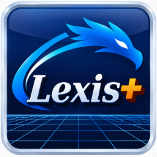

Lexis+ &
wdlexis+ - l'atelier du langage Lexis+<br/>
© 2026 Jean‑Marc "jihem"Quéré, sonaliwan.fr<br/>
SIRET 13033319800013<br/>
Distribué sous licence CC BY‑NC‑SA 4.0.<br/>

Les utilisations commerciales ne sont pas couvertes par cette licence.<br/>
Pour obtenir une autorisation d'utilisation commerciale,<br/>
contactez l'auteur : metalab (at) sonaliwan.fr.<br/>

[]()

# wdlexis+ écrit en Lexis+

L'atelier wdlexis+ réécrit dans son propre langage.

```
wdlexisrt principal.prg [dossier_du_projet]
```

Sans dossier, l'atelier rouvre le dernier projet (ou, au premier lancement, son
propre dossier).

## Fonctions de l'atelier natif reprises

| Atelier natif | Ici |
| --- | --- |
| Menus Fichier, Édition, Recherche, Exécuter, Conception, Affichage, Aide | mêmes menus, mêmes libellés (`menus.prg`) |
| Barre d'outils, barre d'état, position du curseur | oui |
| Deux fenêtres : outils à gauche (refermable, *Affichage > Fenêtre Projet / Structure / Référence*), documents à droite | oui (`ui.fenetre{x=, y=}`) |
| Page Projet (arbre des fichiers) | oui |
| Page Structure en arbre : procédures, fonctions (et leurs locales), globales | oui (`lexis.structure`) ; un clic centre aussi la fenêtre Blueprint sur le nœud quand elle montre ce fichier |
| Page Référence : recherche, paquets par ordre alphabétique, fiche Markdown sous un séparateur horizontal, double-clic pour insérer | oui ; les fiches sont générées en Lexis+ (`reference.prg`) ; dans la fenêtre Blueprint, la palette des entités propose les mêmes fonctions |
| Éditeur à onglets, coloration, complétion, minicarte | contrôle natif `ui.editeur` |
| Pastille de couleur par onglet (rouge code, orange formulaire, jaune état) et son clic | oui : la nature et l'action du clic sont décidées en Lexis+ (`edition.prg`) |
| Fenêtre Blueprint (comme les fenêtres Concepteur) : barre d'outils, fichiers ouverts, palette des entités à masquer, afficher ou détacher dans sa propre fenêtre, graphe éditable, détails, plier / déplier, liens d'appel, icône fichier (double-clic : l'autre fichier en blueprint) | fenêtre native `ui.blueprint` ; ouverture, fermeture, synchronisation (`vb:suivre`) et signaux en Lexis+ |
| Vue projet (Conception, premier élément) : une colonne par fichier, procédures et fonctions dans l'ordre du source, liens d'appel ; clic : appelées / appelants ; double-clic : le code | oui (`vueprojet.prg`) : analyse `lexis.graphe`, dessin `ui.diagramme`, mêmes dispositions et couleurs |
| Problèmes pendant la frappe, soulignés, clic pour aller à la ligne | oui (`lexis.verifier`) |
| Vérifier les fichiers ouverts | oui |
| Exécuter, console avec saisie, erreur → ligne fautive | oui (`lexis.executer`) |
| Débogueur : F5, F9, F10, F11, Maj+F11, Pause, Arrêter | oui (`surpause`, `x:pas()`…) |
| Variables, Pile d'appels (clic : variables du cadre) | oui |
| Rechercher, Remplacer, F3 / Ctrl+H, Aller à la ligne, F12 définition | oui (`ui.rechercher`, `ed:chercher`…) |
| Police, minicarte, thème sombre / clair, options d'analyse | oui, conservés dans `~/.wdlexis-atelier.json` |
| Session (fichiers ouverts), arguments, fichier principal | oui, dans `.wdlexis/atelier.json` du projet |
| Fichier > Exporter le projet (archive)… / Importer un projet (archive)… : `.zip` ou `.tar.gz`, dossier de tête au nom du projet, sans fichiers cachés ni `distribution/` (réglages de génération gardés) ; l'import refuse d'écraser un projet existant puis ouvre le projet | oui (`projet.prg`, paquet `archive`) ; natif : `ide/projarchive.nim` |
| Générer l'application, icône avec aperçu et cadrage (glisser le cadre, molette ou coin : taille) | boîte en Lexis+ (`ui.cadrage`), compilation par l'outil `wdlexisgen` (`--icone=`, `--cadrage=`) ; mêmes réglages (`.wdlexis/application.ini`) |
| Concepteur de formulaires (menu Conception, double-clic sur un `form_<nom>.prg`) | oui (`concepteur.prg`) ; mêmes fichiers `form_<nom>.prg` que l'atelier natif |
| Éditeur d'états PDF (menu Conception, double-clic sur un `etat_<nom>.prg`) | oui (`etats.prg`) ; mêmes fichiers `etat_<nom>.prg` que l'atelier natif |

## Ce qui est en Lexis+ et ce qui est natif

| Partie | Où |
| --- | --- |
| Toute l'interface, les menus, la logique d'atelier | les 11 fichiers `.prg` (environ 4 400 lignes) |
| Éditeur de code | natif : `ui.editeur` (`ide/codeeditor.nim`) |
| Fenêtre Blueprint : modèle code ↔ graphe, canevas, palette des entités (DockPane), détails | natif : `ui.blueprint` (`ide/bpmodel.nim`, `ide/blueprint.nim`, `ide/dockpane.nim`) |
| Pastilles : nature des documents, clic, ouverture et fermeture des vues, Structure et fenêtre Blueprint | `edition.prg`, `projet.prg` |
| Vue projet : analyse du projet | natif : `lexis.graphe` (`ide/lexislint.nim`) |
| Vue projet : fenêtre, colonnes, liens, mise en évidence, ouverture du code | `vueprojet.prg` |
| Cadrage de l'icône (aperçu, cadre) | natif : `ui.cadrage` (`ide/cropview.nim`) ; la boîte est dans `generation.prg` |
| Analyse du langage | natif : `lexis.verifier`, `lexis.structure` (`ide/lexislint.nim`) |
| Exécution et débogage dans un interpréteur séparé | natif : `lexis.executer` (`paquets/pkg_lexis.nim`) |
| Compilation de l'application | outil `wdlexisgen` (chaîne Zig) |
| Concepteur : canevas, palette, modèle, génération de `form_<nom>.prg` | natif : `ui.concepteur`, `ui.palette` (`ide/designer.nim`, `ide/formmodel.nim`) |
| Concepteur : fenêtre, hiérarchie, inspecteur, procédures, câblage, renommage | `concepteur.prg` |
| États : canevas, palette, modèle, mise en page, PDF | natif : `ui.etat`, `ui.paletteetat` (`ide/reportdesigner.nim`, `ide/etats.nim`, `ide/pdfwriter.nim`) |
| États : fenêtre, hiérarchie, inspecteur, renommage, aperçu, code d'exemple | `etats.prg` |

## Mesures (Linux, écran virtuel, frappe simulée à ~30 caractères/s)

| Fichier | Analyse + problèmes + structure |
| --- | --- |
| 14 lignes | 1 à 2 ms |
| 2 000 lignes | 54 à 96 ms ; l'affichage rattrape la frappe en moins de 0,3 s |

La frappe reste instantanée : l'éditeur est natif. Pendant une rafale de
frappes, l'atelier n'analyse pas deux fois le même texte.

## Différences connues avec l'atelier natif

- Les fichiers modifiés sont enregistrés avant l'exécution (l'atelier natif
  exécute les documents tels qu'à l'écran, même non enregistrés).
- Pendant la génération, le détail s'affiche dans la Console de l'atelier
  une fois l'outil terminé, pas au fil de l'eau.
- Les gestionnaires d'événements s'exécutent chacun sur leur fil, dans un ordre
  non garanti : l'atelier relit l'état réel (`ed:curseur()`) au lieu de se fier
  à l'ordre d'arrivée.

### Encore une chose !
Un p'tit geste qui peut - grandement - nous aider... \[La caféïne c'est important pour une équipe de neuro-atypiques : TSA, TDAH, TAG, HPI et/ou THPI (membres de **mensa.fr** et de **triplenine.org**).\]

[](https://buymeacoffee.com/sonaliwan.fr)
