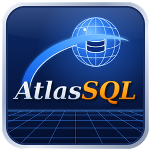

Atlas SQL, Lexis+ &
wdlexis+ - l'atelier du langage Lexis+<br/>
© 2026 Jean‑Marc "jihem"Quéré, sonaliwan.fr<br/>
SIRET 13033319800013<br/>
Distribué sous licence CC BY‑NC‑SA 4.0.<br/>

Les utilisations commerciales ne sont pas couvertes par cette licence.<br/>
Pour obtenir une autorisation d'utilisation commerciale,<br/>
contactez l'auteur : metalab (at) sonaliwan.fr.<br/>

[]()

# Atlas SQL — architecture

## 1. Vue d'ensemble

```
            +------------------------ Interface (wdgui) -------------------------+
            | explorateur · fil d'Ariane · 15 vues · éditeur · propriétés · file |
            +---------------^-------------------------------+--------------------+
                 vues lisent| (SQL)                commandes| (travaux)
            +---------------+---------------+  +------------v-------------------+
            |   Modèle : entrepôt DuckDB    |<-+ Contrôleur : file + 3..10      |
            |   <projet>/atlas.duckdb       |  | agents (sessions DuckDB)       |
            +---------------^---------------+  +------------+-------------------+
                            | écrit                         | exécute
            +---------------+-------------------------------v--------------------+
            | Services / moteurs : extraction, analyse T-SQL, résolution,        |
            | dictionnaire, types, duplications, performances, patrimoine,       |
            | refactoring, interception, assistant                               |
            +---------------^----------------------------------------------------+
                            | ATTACH (TYPE mssql, READ_ONLY) · odbc_query · fichiers .sql
                    SQL Server (n serveurs, n bases)
```

Principes :

- **Tout est local.** Les métadonnées extraites, les résultats d'analyse, la file, le journal,
  les favoris et les espaces de travail vivent dans une seule base DuckDB par projet. Les
  vues ne font que des requêtes SQL sur cette base, elles n'appellent jamais SQL Server.
- **Extraire une fois, analyser hors ligne.** Les serveurs ne sont interrogés que par les
  travaux d'extraction, en lecture seule, avec une limite de concurrence par serveur.
- **Ensembliste.** Les traitements lourds (tokenisation, résolution, duplication, métriques)
  sont écrits en SQL DuckDB. Lexis orchestre et ne boucle pas sur des caractères.

## 2. Organisation des modules (fichiers `.prg`)

| Module | Rôle (MVC) | Contenu principal |
|---|---|---|
| `principal.prg` | Vue + amorçage | fenêtre, menus, barre d'outils, explorateur, fil d'Ariane, navigation (historique, favoris), recherche, fiche des propriétés |
| `vues.prg` | Vues | accueil, carte, dépendances, dictionnaire, types, flux, doublons, SQL dynamique, perfs, patrimoine, constats |
| `editeur.prg` | Vue + service | éditeur T-SQL, synoptique, arbre, analyse en direct, débogueur symbolique, refactoring |
| `interception.prg` | Vue + service | capture XE, import, simulation, rejeu, export des appels |
| `assistant.prg` | Service | moteur de questions-réponses (règles et entrepôt), modèle GGUF local ou API compatible OpenAI |
| `menus.prg` | Contrôleur | menus, exports CSV et Markdown, projets, espaces de travail, aide |
| `agents.prg` | Contrôleur | file d'attente, dépendances entre travaux, ordonnanceur, agents, panneau de suivi |
| `sources.prg` | Service | connexions, secrets, extraction T-SQL, normalisation, planification d'une campagne |
| `sqlanalyse.prg` | Moteur | lexer (regex DuckDB), découpage en instructions, AST, références, variables, SQL dynamique, jointures, règles, constats |
| `dependances.prg` | Moteur | résolution des noms (serveurs liés, synonymes, OPENQUERY, FK, déclencheurs), relations, impact transitif, flux |
| `analyses.prg` | Moteurs | dictionnaire intelligent, types métier, duplications, performances, patrimoine |
| `entrepot.prg` | Modèle | schéma DuckDB, accès (`RQ`, `RV`, `INSERER_LIGNES`), réglages, utilitaires de présentation |
| `demo.prg` | Données | système d'information simulé (3 serveurs, 4 bases, environ 40 modules, jobs, statistiques, captures) |

## 3. Modèle de données (DuckDB)

### 3.1 Zone d'extraction (`ext_*`) : le brut, par source

| Table | Contenu |
|---|---|
| `sources` | serveurs déclarés : genre, hôte, base, authentification, options, limite, dernière analyse |
| `ext_objets` | tables, vues, procédures, fonctions, déclencheurs, synonymes, séquences, types, serveurs liés, contraintes, index ; définition et taille |
| `ext_colonnes` | colonnes : type, longueur, nullabilité, identité, calcul, défaut, PK, FK |
| `ext_dependances` | dépendances déclarées par SQL Server (`sys.sql_expression_dependencies`) |
| `ext_stats` | statistiques d'exécution (`sys.dm_exec_*_stats`) et plans XML |
| `ext_index_manquants` | DMV des index manquants |
| `ext_jobs` | jobs SQL Agent, étapes, commandes, horaires, durées |
| `ext_profils` | profilage des colonnes (distincts, nuls, exemples) |

### 3.2 Référentiel normalisé

| Table | Contenu |
|---|---|
| `objets` | un objet par ligne : id, clé `serveur.base.schéma.nom`, genre, parent, définition, volumétrie |
| `colonnes` | colonnes enrichies du profilage |
| `refs_brutes` | références trouvées dans le code (1 à 4 parties, nature, ligne, SQL) avant résolution |
| `dependances` | graphe orienté résolu : de → vers, nature (SELECT, INSERT, UPDATE, DELETE, MERGE, EXEC, APPEL, FK, DECLENCHEUR, SYNONYME…), inter-base, inter-serveur, fréquence, volume moyen et maximal, complexité |
| `instructions` | instructions de chaque module : lignes, genre, phase, profondeur, texte normalisé, empreinte, tables |
| `ast` | arbre syntaxique simplifié (blocs, contrôles, requêtes) |
| `variables` | paramètres, variables, tables temporaires, variables tables, curseurs, CTE |
| `sql_dynamique`, `dyn_variantes` | SQL dynamique reconstitué et historique de ses variantes |
| `jointures`, `regles` | jointures et règles de gestion (CASE, IF, contrôles) normalisées |
| `stats_requetes`, `index_manquants` | performances rattachées aux objets |
| `diagnostics` | constats de tous les moteurs : module, règle, niveau, message, suggestion, correctif, ligne |
| `dico_tables`, `dico_colonnes` | dictionnaire intelligent : objet métier, famille, nature, sensibilité, RGPD, descriptions |
| `types_metier` | types métier déduits et variantes de types SQL |
| `duplications` | groupes de doublons : genre, similarité, extrait, proposition |
| `metriques` | patrimoine : lignes, complexité, couplage entrant et sortant, cohésion, dette, maintenabilité, réutilisation, classe, score |
| `captures` | appels interceptés : texte, paramètres JSON, durée, lignes, application |

### 3.3 Fonctionnement de l'atelier

| Table | Contenu |
|---|---|
| `travaux` | historique de la file : genre, cible, priorité, état, agent, dates, durée, message |
| `journal` | événements |
| `favoris`, `espaces` | navigation et espaces de travail |
| `meta` | indicateurs globaux (version du schéma, % de duplication, dette totale) |

## 4. File d'attente et agents (contrôleur)

- Un **travail** contient : `genre`, `libelle`, `cible`, `source_id`, `serveur`, `priorite`,
  `apres` (dépendances) et des paramètres. `AJOUTER_TRAVAIL` le place dans la file en mémoire
  (`file.travaux`) et le journalise dans `travaux`.
- `PLANIFIER` construit le graphe d'une campagne :
  - inventaire → extractions → normalisation ;
  - normalisation → lots d'analyse → résolution ;
  - dictionnaire → types ;
  - résolution → duplications et performances ;
  - tout le reste → patrimoine.
- `DISPATCHER` est une minuterie de 300 ms. Elle démarre les agents (au plus `reglages.agents`),
  détecte la fin d'un lot et rafraîchit le panneau.
- `PRENDRE_TRAVAIL` choisit le travail prêt de plus haute priorité, à condition que le serveur
  ciblé ait moins de `reglages.parserveur` travaux en cours.
- Chaque agent est un fil (`AGENT_FIL`) avec sa propre `sessionsql()`. Les requêtes DuckDB
  libèrent le verrou de l'interpréteur, donc les agents travaillent réellement en parallèle.
- `PROGRES(t, p, msg)` publie l'avancement et lève une erreur si le travail a été annulé.
  `interromprebase` coupe une requête en cours.
- Genres de travaux : `inventaire`, `extraction`, `normalisation`, `analyse`, `resolution`,
  `dictionnaire`, `types`, `duplications`, `performances`, `patrimoine`, `profilage`,
  `captures`, `rejeu`.

## 5. Services et moteurs

### 5.1 Extraction (`sources.prg`)

- `ATTACHER` attache une source (mssql : `ATTACH '<chaîne>' AS srcN (TYPE mssql, READ_ONLY)` ;
  ODBC : `odbc_query`).
- `TSQL(genre)` donne les requêtes catalogue paramétrées par base (`{B}`).
- `EXTRAIRE` exécute la requête, puis insère le résultat en masse avec
  `insert … by name select unnest(from_json(?, …))`.
- `NORMALISER` transforme `ext_*` en référentiel (objets, colonnes, jobs rattachés à la base de
  leurs étapes, statistiques, index manquants) et découpe le code en lots d'analyse.

### 5.2 Analyse T-SQL (`sqlanalyse.prg`)

| Fonction | Rôle |
|---|---|
| `SQL_JETONS(s, texte)` | lexer par expression régulière DuckDB : chaînes, identifiants, variables, mots-clés, nombres, opérateurs, avec n° de ligne |
| `INSTRUCTIONS(toks)` | découpage en instructions (règles de continuation T-SQL, BEGIN/END, IF/ELSE, TRY/CATCH) |
| `ANALYSER_JETONS(toks, ctx)` → `R` | `instructions`, `ast`, `refs`, `vars`, `dyn`, `jointures`, `regles`, `diag`, `complexite`, `params`, `phases` |
| `REFERENCES_INSTR` | noms à 1 à 4 parties, alias, OPENQUERY et OPENROWSET, fonctions, tables temporaires, INSERTED/DELETED |
| `AFFECTATIONS`, `DYNAMIQUE_EXEC` | reconstitution du SQL dynamique (concaténations, `sp_executesql`, paramètres) |
| `PHASE_INSTR` | phases logiques : Initialisation, Déclarations, Contrôles, Chargement, Transformation, Écriture, Nettoyage, Retour |
| `CONSTATS` | SELECT *, UPDATE/DELETE sans WHERE, fonction sur colonne filtrée, LIKE '%…', NOT IN, NOLOCK, @@IDENTITY, GOTO, curseurs, injection, transaction sans TRY, WAITFOR, ROWCOUNT, boucles |
| `FORMATER_SQL` | mise en forme |

Le même moteur sert à l'analyse en masse (lots, agents) et à l'éditeur (analyse différée à
chaque frappe).

### 5.3 Dépendances et cartographie (`dependances.prg`, `vues.prg`)

- `RESOUDRE` résout en SQL. Il tient compte du contexte serveur, base et schéma, des serveurs
  liés vers leur cible, des synonymes (relation directe plus « via synonyme »), d'OPENQUERY, des
  FK, des déclencheurs et des dépendances du catalogue. Il calcule fréquence et volumes à partir
  des statistiques. Les noms non résolus deviennent des constats.
- `RELATIONS(id, sens, question)` répond à qui lit, qui écrit, qui supprime, qui met à jour et
  qui appelle. `IMPACT_TRANSITIF` utilise une CTE récursive. `IMPACT_COLONNE` et `FLUX` donnent
  les chaînes table → traitement → table.
- La cartographie a cinq niveaux : global (serveurs et liens inter-serveurs), serveur (bases),
  base (schémas), schéma (objets) et objet (voisinage à 1 ou 2 sauts). Elle offre zoom, ajustement,
  disposition automatique, recentrage, historique et fenêtre détachable.

### 5.4 Dictionnaire intelligent et types métier (`analyses.prg`)

- Le dictionnaire s'appuie sur un **glossaire** (abréviations → mots, familles, sensibilités),
  surchargeable par `<projet>/glossaire.json`. Les noms sont découpés en mots (`MOTS_NOM`) pour
  en déduire l'objet métier, la famille, la nature (référentiel, transactionnelle, historique,
  temporaire, technique, archive), la sensibilité et la catégorie RGPD.
- Les types métier regroupent les colonnes par concept normalisé (`CODE_CLI`, `CLI_CODE`… →
  `TYPE_CODE_CLIENT`) et signalent les types SQL divergents.

### 5.5 Duplications, performances, patrimoine (`analyses.prg`)

- **Duplications** : empreintes identiques, similarité de Jaccard sur trigrammes de jetons,
  jointures et règles répétées. Pour chaque groupe, une proposition de mutualisation.
- **Performances** : balayages, jointures coûteuses (opérateurs du plan), index manquants avec
  `CREATE INDEX`, jointures sans index. Les constats de l'analyse sont reclassés.
- **Patrimoine** : complexité cyclomatique, couplage (entrant et sortant), cohésion, dette (en
  minutes), maintenabilité de 0 à 100, réutilisation, score de risque. Classes : *Critique*,
  *Sensible*, *Obsolète*, *Inutilisé*, *À refactoriser*.

### 5.6 Éditeur, débogueur, refactoring (`editeur.prg`)

- **Éditeur** : coloration T-SQL, complétion des noms de l'entrepôt, diagnostics soulignés,
  extraits, mise en forme, renommage, aller à la définition (F12), exécution en lecture seule
  sur la source. Le **synoptique** (diagramme des phases) et l'**arbre** sont synchronisés avec
  le curseur.
- **Débogueur symbolique** : pas à pas (F10), pas détaillé dans les EXEC (F11), jusqu'au curseur,
  points d'arrêt (F9), continuer (F5), pile d'appels. Les variables sont évaluées
  symboliquement. Les paramètres viennent du dernier appel capturé.
- **Refactoring** : renommer (objet ou colonne), extraire une procédure, découper par phases,
  fusionner des doublons. L'impact est calculé sur tout le patrimoine et un aperçu avant/après
  précède la génération du script.

### 5.7 Interception (`interception.prg`)

- Le script de **session Extended Events** (`rpc_completed` et `sql_batch_completed`) s'installe
  côté serveur sans modifier les clients.
- L'**import** lit les événements via la source ou un fichier. Le texte et les paramètres sont
  extraits en JSON.
- **Simuler** ouvre le débogueur avec les paramètres, modifiables. **Rejouer** passe par un
  travail `rejeu` dans `BEGIN TRAN … ROLLBACK`, après confirmation (simulé en démonstration).
  **Exporter** produit un CSV.

### 5.8 Assistant (`assistant.prg`)

- Un moteur de règles répond sans modèle à : qui lit, écrit ou appelle ; RGPD ; inutilisés ;
  inter-serveurs ; SQL dynamique ; types ; « combien » ; impact ; anomalies ; optimise ;
  refactorise ; documente ; explique ; résume.
- Un modèle optionnel peut être branché : GGUF local (paquet `llm`) ou API HTTP compatible
  OpenAI. Il reçoit un contexte construit depuis l'entrepôt (fiche, dépendances, constats).

## 6. Interface : écrans

| Zone | Composants | Comportement |
|---|---|---|
| Barre d'outils | << / >> et ⧉ (panneau de gauche), + Source, ▶ Analyser, File, recherche, ◀ ▶, ☆, Recentrer, Code, Impact, fil d'Ariane (serveur › base › schéma › objet), indicateur de file | une seule ligne de boutons plats ; chaque niveau du fil ouvre sa cartographie |
| Gauche | onglets Objets, Chercher, Favoris, Récents, Propriétés (fiche Markdown) | visible, masqué (le séparateur garde sa position) ou détaché dans sa fenêtre ; à la fermeture de celle-ci, il revient à gauche |
| Centre | 15 onglets de vues | une vue suit l'objet courant quand elle est affichée |
| Bas | File d'attente, Console, Journal | curseur de 3 à 10 agents, limite par serveur, grille, cartes des agents, Gantt |

L'**objet courant** est l'unique point de synchronisation. `ALLER_OBJET` met à jour
l'historique, le fil d'Ariane, la fiche et la vue active. Les vues lourdes ne sont recalculées
qu'à l'activation de leur onglet (`VUE_ACTIVEE`). Les séparateurs, le thème, la police et le
nombre d'agents sont persistés dans `~/.atlassql.json`.

Le panneau de gauche vit dans un conteneur hôte, premier volet du séparateur central, lui-même
placé dans le conteneur « centre ». Le **masquer** (ou le détacher) déplace les vues dans « centre »
et cache le séparateur : aucune barre inutile ne reste à l'écran, et le séparateur, conservé,
retrouve sa position quand les vues y reviennent. Le **détacher** déplace le contrôle d'onglets
(`fenpanneau:ajouter(gauche)`) dans une nouvelle fenêtre ; à sa fermeture, `hote:ajouter(gauche)`
le ramène. wdgui libère alors les textures mises en cache par l'ancienne fenêtre avant le
premier rendu dans la nouvelle.

## 7. Performances

- La tokenisation passe par `regexp_extract_all` dans DuckDB : environ 40 000 jetons en 0,3 s.
- Les insertions se font en masse par lots de 400 lignes via `unnest(from_json(…))`.
- La démonstration complète (37 travaux, 4 agents) s'exécute en environ 5 s.
- Les agents ont des sessions DuckDB indépendantes. Comme l'interpréteur Lexis est sérialisé,
  le parallélisme vient des requêtes SQL, qui portent l'essentiel du travail.

## 8. Plan de livraison incrémental

| Étape | Contenu | État |
|---|---|---|
| **MVP** | inventaire mssql/ODBC/scripts, entrepôt DuckDB, file et agents, analyse T-SQL, dépendances, explorateur, recherche, fiche, carte | livré |
| **V1** | dictionnaire, types métier, flux, SQL dynamique, perfs, constats, exports | livré |
| **V2** | éditeur avancé, synoptique, débogueur symbolique, refactoring avec aperçu, duplications, patrimoine | livré |
| **V3** | interception XE, simulation, rejeu transactionnel, assistant (règles plus LLM optionnel), espaces de travail, fenêtres détachables | livré (rejeu réel à valider sur serveur) |
| **Enterprise** | analyse incrémentale (diff des définitions), multi-utilisateur (entrepôt partagé ou export Parquet), historisation des campagnes, connecteurs SSIS/SSRS/ADF, lignage colonne à colonne complet, exécution réelle pas à pas, intégration CI (constats en échec de build), plugins de règles | à faire |

## 9. Limites (état actuel)

- **Débogueur** : il est symbolique. Il ne se branche pas sur le débogueur T-SQL de SQL Server,
  qui a disparu des outils Microsoft. Les valeurs calculées par des requêtes sont marquées
  « symboliques ».
- **Rejeu** : il passe par une transaction annulée. Les effets hors transaction (envoi de
  mails, appels externes, séquences, `IDENTITY`) ne sont pas annulés.
- **Analyseur** : il est tolérant, sans grammaire T-SQL complète. Les constructions rares (XML
  DML, CLR, certaines options de requête) sont traitées comme du texte.
- **Tests** : l'accès SQL Server réel (extension `mssql`) n'a pas été testé contre une instance
  dans l'environnement de développement. La démonstration, l'analyse, la file et l'interface
  ont été testées.
- **Interface** : pas d'ancrage libre des panneaux, pas de repli du code, pas de sélection
  multiple dans le diagramme. Les onglets trop nombreux sont abrégés par « … ».

### Encore une chose !
Un p'tit geste qui peut - grandement - nous aider... \[La caféïne c'est important pour une équipe de neuro-atypiques : TSA, TDAH, TAG, HPI et/ou THPI (membres de **mensa.fr** et de **triplenine.org**).\]

[](https://buymeacoffee.com/sonaliwan.fr)
