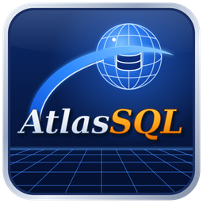

Atlas SQL, Lexis+ &
wdlexis+ - l'atelier du langage Lexis+<br/>
© 2026 Jean‑Marc "jihem"Quéré, sonaliwan.fr<br/>
SIRET 13033319800013<br/>
Distribué sous licence CC BY‑NC‑SA 4.0.<br/>

Les utilisations commerciales ne sont pas couvertes par cette licence.<br/>
Pour obtenir une autorisation d'utilisation commerciale,<br/>
contactez l'auteur : metalab (at) sonaliwan.fr.<br/>

[]()

# Atlas SQL — cartographie, analyse et outillage du patrimoine SQL Server

Atlas SQL est un atelier écrit en **Lexis+** (wdlexis+) qui inventorie un ou plusieurs serveurs
SQL Server, analyse tout le code T-SQL et permet de comprendre, documenter, déboguer et
refactoriser le patrimoine. Toutes les données sont stockées **localement**, dans une base
**DuckDB** propre à chaque projet (`<projet>/atlas.duckdb`).

## Lancer

```
wdlexis+ exemples/atlassql/principal.prg [dossier_projet]
```

- Sans argument, le projet est `~/AtlasSQL`. **Fichier › Nouveau projet… / Ouvrir un projet…** change de dossier.
- Pour essayer sans serveur : **Sources › Ajouter la démonstration**, puis **▶ Analyser** (F5).
  La démonstration simule 3 serveurs (SRV-ERP avec les bases ERP et REF, SRV-COMPTA, SRV-DWH),
  avec environ 40 modules réalistes, des jobs, des serveurs liés, des synonymes, des statistiques
  d'exécution, des plans et des appels capturés.

## Déclarer une vraie source

**+ Source** ouvre la fiche de connexion :

| Genre | Accès | Remarques |
|---|---|---|
| SQL Server (mssql) | extension DuckDB `mssql` (`ATTACH … (TYPE mssql, READ_ONLY)`) | installée automatiquement à la première connexion |
| ODBC | extension `nanodbc` (`odbc_query`) | utilise un DSN ou une chaîne ODBC |
| Dossier de scripts | fichiers `.sql` | analyse hors ligne (dépôt Git, export SSMS…) |
| Démonstration | données simulées | aucun réseau |

Authentification : SQL Server (utilisateur et **mot de passe**, saisis dans la fiche), Windows
(SSPI / Kerberos) ou Entra ID (nom d'un secret DuckDB `azure` dans le champ utilisateur).
**Tester** essaie la connexion avec ce qui est saisi, sans rien enregistrer ; un échec affiche le
message du serveur et une piste (certificat, identifiants, port, extension).
Si la négociation TLS échoue, **Tester** essaie aussi les autres réglages de chiffrement
(certificat accepté, puis connexion non chiffrée), coche celui qui fonctionne et le signale ; il
reste à **Enregistrer**. Un serveur qui impose le chiffrement strict (TDS 8.0, *Force Strict
Encryption* de SQL Server 2022/2025) peut ne pas être accepté par l'extension : désactivez cette
option côté serveur ou utilisez le genre ODBC (ODBC Driver 18).

Options :
- *Faire confiance au certificat* (`TrustServerCertificate`) : nécessaire avec un certificat
  auto-signé, ce qui est le cas par défaut de SQL Server 2022 et 2025 (cochée par défaut).
- *Chiffrer la connexion* (`Encrypt`, cochée par défaut).
- *Profiler les colonnes* : nombre de valeurs distinctes et de nuls, exemples.
- *Statistiques d'exécution* : DMV et plans en cache.

La connexion est toujours attachée en lecture seule (`READ_ONLY`). Le mot de passe est gardé en
mémoire pour la session ; si *Mémoriser sur ce poste* est coché, il est aussi chiffré, avec une clé
propre au poste, dans `~/.atlassql-secrets.json`. Il n'est jamais écrit dans la base du projet.
En modification, laisser le champ vide conserve le mot de passe mémorisé.

Droits SQL Server conseillés : `VIEW DEFINITION`, `VIEW SERVER STATE` (statistiques) et lecture
de `msdb` (jobs). Atlas n'écrit **jamais** dans les bases analysées. La seule exception est le
rejeu d'un appel capturé : il s'exécute dans une transaction annulée (`ROLLBACK`), et seulement
après confirmation.

## La file d'attente et les agents

Une campagne d'analyse est découpée en **travaux** :

1. inventaire ;
2. extractions (objets, colonnes, modules, dépendances, statistiques, index manquants, jobs, profils) ;
3. normalisation ;
4. lots d'analyse du code ;
5. résolution des dépendances ;
6. dictionnaire et types métier ;
7. duplications et performances ;
8. patrimoine.

Les travaux sont placés dans une file avec leurs **dépendances**. Ils sont exécutés en parallèle par
**3 à 10 agents**, réglés par le curseur du panneau *File d'attente*. Chaque agent possède sa propre
connexion DuckDB. Une limite **par serveur** (1 à 10) évite de surcharger une même instance
SQL Server : un serveur de production peut être limité à 1 ou 2 requêtes simultanées pendant
que le reste avance.

Commandes de la file :

- **Pause** : les travaux en cours se terminent, aucun autre ne démarre.
- **Arrêter** : interrompt les requêtes en cours.
- **Relancer** : remet en file les travaux en erreur ou annulés.
- **Priorité** et **Annuler** : agissent sur le travail sélectionné.
- **Nettoyer** : retire les travaux terminés de la liste.

Un double-clic sur un travail affiche son détail. La chronologie (Gantt) montre l'occupation de
chaque agent. Les réglages sont conservés dans `~/.atlassql.json`.

## L'interface

- **Panneau de gauche** : cinq pages.
  - *Objets* : serveurs › bases › schémas › genres › objets, chargés à la demande ; jobs SQL
    Agent et serveurs liés au niveau du serveur. Repères : ◆ critique, 🔒 données personnelles,
    ∅ inutilisé ou obsolète.
  - *Chercher* : objets, colonnes, objets métier, texte du code.
  - *Favoris* (Ctrl+D) et *Récents*.
  - *Propriétés* : la fiche de l'objet courant. Ses liens ouvrent le code, les dépendances,
    l'impact et la cartographie.

  Deux boutons, au début de la barre d'outils, pilotent ce panneau :
  - **<<** le masque et laisse toute la largeur aux vues ; le bouton devient **>>**, qui le
    réaffiche à la largeur qu'il avait (le séparateur garde sa position).
  - **⧉** l'ouvre dans une fenêtre séparée (second écran) ; l'espace de gauche est alors libéré.
    Fermer cette fenêtre, ou cliquer **⧈** ou **>>**, remet les pages à gauche.

  L'état masqué et la largeur sont retrouvés à la prochaine ouverture.
- **Barre d'outils** (une seule ligne, sous les menus) : panneau, campagne, recherche, navigation, puis le **fil d'Ariane** serveur › base › schéma › objet (chaque niveau ouvre sa cartographie) et l'état de la file.
- **Vues** (centre) :

  | Onglet | Contenu |
  |---|---|
  | Accueil | indicateurs, graphiques, objets à risque, synthèse |
  | Carte | vues globale, serveur, base, schéma et objet ; zoom, disposition, recentrage, fenêtre détachable |
  | Dépendances | qui lit, écrit, supprime, met à jour, appelle ; impact transitif |
  | Dictionnaire | objets métier, familles, sensibilité, RGPD, descriptions ; export Markdown |
  | Types | types métier déduits (CODE_CLIENT…) et incohérences de types SQL |
  | Code | éditeur T-SQL, synoptique, arbre syntaxique, analyse, dépendances, débogueur, résultats |
  | Flux | vues flux, Sankey (volumes), pipeline et temporelle (jobs) |
  | Doublons | code identique ou voisin, jointures et règles répétées ; proposition de mutualisation |
  | Dynamique | SQL dynamique reconstruit, variantes et valeurs observées |
  | Perfs | statistiques, opérateurs coûteux, index manquants, script de corrections |
  | Patrimoine | dette, couplage, cohésion, complexité, maintenabilité ; classements |
  | Refacto | renommer, extraire, découper, fusionner, avec impact et aperçu avant/après |
  | Captures | interception des appels : capture XE, import, simulation, rejeu, export |
  | Assistant | questions en français sur le patrimoine (moteur de règles, ou modèle local ou distant) |
  | Constats | tous les diagnostics, filtrables par module et par niveau |

- **Bas** : *File d'attente*, *Console* et *Journal*. Les séparateurs sont mémorisés.
- **Barre d'état** : une ligne fine collée au bas de la fenêtre.

L'interface utilise la densité compacte de wdgui (marges et hauteurs réduites, boutons plats ajustés
à leur libellé) pour laisser le maximum de place aux données.
- **Espaces de travail** : **Affichage › Enregistrer l'espace de travail…** conserve la disposition, la vue
  et l'objet courant.

Raccourcis :

| Touche | Action |
|---|---|
| F5 | analyser |
| Ctrl+F | rechercher |
| Ctrl+D | favori |
| Alt+← / Alt+→ | historique |
| F12 | aller à la définition (éditeur) |
| F9 / F10 / F11 | point d'arrêt / pas / pas détaillé (débogueur) |

## Limites connues

Elles sont présentées honnêtement dans `ARCHITECTURE.md` (§ 9). En bref :

- Le débogueur est **symbolique** : il parcourt les instructions et suit les variables et les
  branches à partir de valeurs connues. Il n'exécute pas pas à pas sur le serveur.
- Le rejeu passe par une transaction annulée.
- L'accès réel à SQL Server repose sur l'extension DuckDB `mssql`. Il n'a pas pu être testé contre
  une vraie instance dans l'environnement de développement : seule la démonstration a été validée
  de bout en bout.
- L'analyseur T-SQL est tolérant mais n'est pas un compilateur complet de la grammaire.
- Il n'y a pas d'ancrage libre des panneaux ni de repli du code dans l'éditeur.

### Encore une chose !
Un p'tit geste qui peut - grandement - nous aider... \[La caféïne c'est important pour une équipe de neuro-atypiques : TSA, TDAH, TAG, HPI et/ou THPI (membres de **mensa.fr** et de **triplenine.org**).\]

[](https://buymeacoffee.com/sonaliwan.fr)
